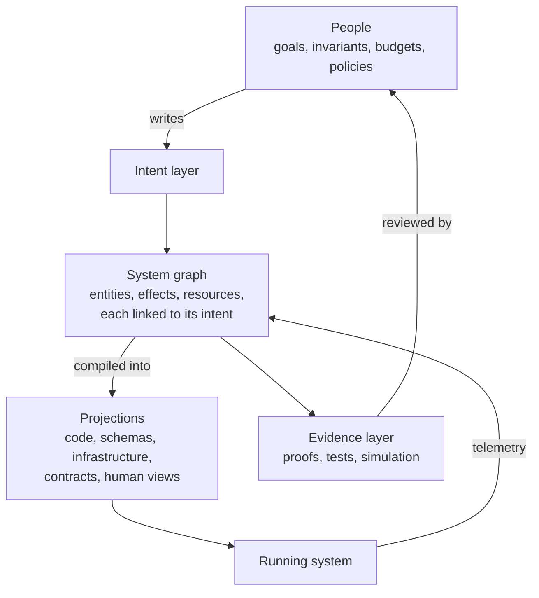
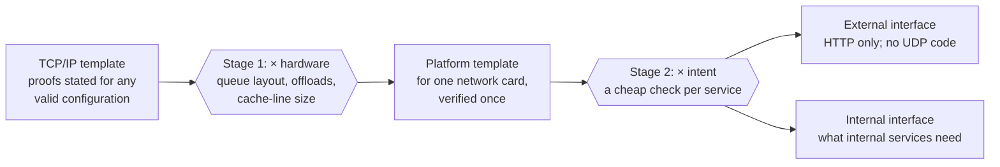
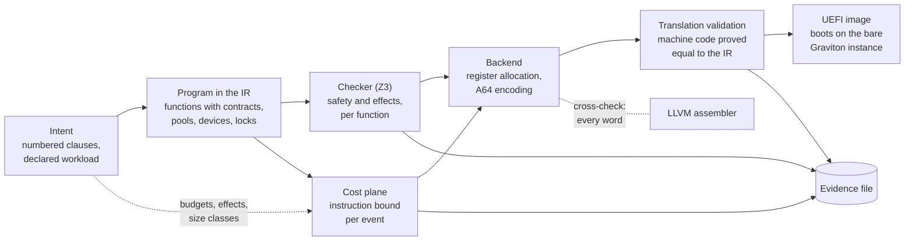
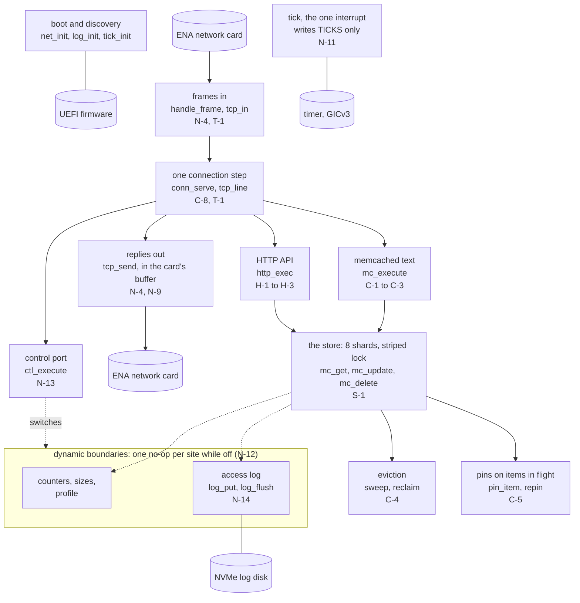

# Intent Driven Regenerative Architecture (IDRA)

**Designing digital systems that AI builds and owns**

First version Nov 5, 2026 · revised Nov 27, 2026 · @Alexandru Rosu

## Abstract

The architecture of digital systems, their software and their hardware alike, has been shaped by what it costs people to design, build, understand, change and check each part. When AI does much of that work, those costs change, though not all at the same rate, and the boundaries of today's systems (programming languages, the operating system, the split into services, even the line between hardware and software) become costs that have to justify themselves. This paper calls the response Intent Driven Regenerative Architecture (IDRA). It argues that architecture should follow the new costs: most of a system should be regenerated from intent, and a boundary should remain only where something real changes across it (representation, rate of change, trust or failure) or where something outside the system requires it. IDRA treats hardware and software as parts of one design, neither of them the fixed platform for the other. Architecture does not disappear. It becomes something the system derives, checks and revises, instead of something people build once and then preserve.

Part I develops the design: one system graph from intent down to machine code, with effects, costs and proofs as mandatory planes of every node; templates specialised by hardware and by workload; boundaries that can be switched, or fused, as evidence comes in; and human projections, the generated views through which the people who own the intent see into the system. Part II reviews what production systems and published research already show. Part III tests the argument with a proof of concept: a memcached-compatible cache generated from intent into a bootable Arm image with no operating system, its memory safety and a bound on the instructions of every event it handles proved, and its machine code checked against the proved program on every build. On an AWS Graviton2 instance it serves 1.5 to 2.6 times the requests of memcached and Redis on Linux, with lower tail latency. With an HTTP API generated into the same image, it serves about 23 times the requests of the same API deployed as two Go services over gRPC, at under a twentieth of the processor cycles per request. The proof of concept was built in about two weeks of spare time by one person, trained in computer science fundamentals and systems design, working with a single AI agent on a $20-a-month subscription. It shows that an AI can build such a system against intent and machine-checked evidence under a human architect, not yet that one can own it unattended. Part IV sets out what remains open, above all the quality of the specifications themselves.

## Preface

The paper began as a thought experiment. What would a digital system look like if humans set only goals and constraints, and an AI owned everything else, from the build down to the hardware? No inherited languages, no general-purpose operating system, no off-the-shelf database: intent at the top, machine instructions at the bottom.

Humans are not guests in this design. They are principals: they own intent, approve irreversible actions, and audit evidence. What they give up is the power to dictate implementation. The principals are a team, not one person, and each of them sees the system through projections made for their own concerns (Chapter 3).

It has since been tested. A proof of concept on Arm cloud servers, described in Part III, generates a working network service from intent with no language, runtime or operating system underneath, and measures what the design claims.

It was tested with very little. The author's background is computer science fundamentals and systems design, not processor architecture, compilers, theorem provers, networking or operating systems. With one AI agent (Claude Opus 5.5 at medium reasoning effort, on a $20-a-month subscription) and a few hours a day of spare time over about two weeks, the author built a toolchain from intent to machine code and a cache that, on its declared workload, serves more requests than memcached and Redis on the same server. Part III gives the measurements and their limits. The point is not the cache. It is that the human role this paper proposes, owning intent and judging evidence, was enough to direct work across the whole stack, hardware contract to network protocol, in fields the author had not worked in, and to learn them along the way at a rate that would not have been possible before.

The paper speaks of digital systems rather than software systems. IDRA treats hardware and software as first-class parts of one design, and the line between them as one more boundary that has to justify itself (Chapters 1 and 5).

The paper is in four parts:

- **Part I, the argument (Chapters 1 to 11).** Chapters 1 to 3 explain why today's boundaries exist and what replaces them. Chapters 4 to 6 descend through the representation, the hardware contract and the operating system. Chapters 7 to 10 develop a theory of boundaries: where they belong, how templates specialise them, and how a running system changes safely. Chapter 11 asks where the approach fits first.
- **Part II, what the literature says (Chapters 12 to 17).** The evidence from production systems and research for each of Part I's claims: what boundaries cost at scale, a system that already separated logical from physical boundaries, compilers and library operating systems, verified software, formal hardware models, and bounding cost.
- **Part III, proving it out on Arm (Chapters 18 to 20).** What was built, the results claim by claim, and what they do not show.
- **Part IV, where this stands (Chapters 21 and 22).** Related work and open problems.

Appendix A is the proof of concept's build log: each step in the order it was taken, with its numbers and the defects found on the way.

The ideas were developed in a long working conversation with Claude, Anthropic's AI model.

# Part I: The argument

## 1. Boundaries drawn for people

Many boundaries in today's software stacks took their shape from human limits, not from the problem being solved. AI does not remove those limits, but it changes what they cost: writing and changing code gets much cheaper, while understanding it and establishing that it is right get cheaper more slowly. That changes which boundaries are worth keeping.

### The human-shaped seams

- **Files and modules** exist partly because no one can read a million lines at once.
- **Service boundaries** often mirror team boundaries, a pattern known as Conway's law.
- **Handoffs** between product, design, development, QA and operations exist because no single person holds every skill.
- **Tickets, sprints and after-the-fact documentation** coordinate people who don't share a mind.
- **Language choice per layer** often reflects the skills a team happens to have.
- **Operating systems** spend much of their effort refereeing between programs that don't trust each other.

None of these is pure waste. Files and modules also provide namespaces, dependency structure and units of compilation. Operating system isolation also contains faults and adversarial code.

### Boundaries that come from the problem

Some boundaries survive any change in who does the work, because they come from the problem itself:

- **Intent versus realization:** what the system must do versus how it does it. Without this split, a bug is indistinguishable from a feature.
- **Trust:** where untrusted input enters and where secrets live.
- **Failure isolation:** blast radius, rollback, the ability to undo.
- **Irreversibility:** deleting data, spending money and sending messages cannot be retried.

### Logical versus physical

The most important distinction in this paper is between a logical boundary and its physical implementation. A logical boundary is a contract: it lets each side be verified separately and changed independently. A physical boundary is what that contract costs at runtime: serialization, copying, network hops, context switches.

Today's systems bundle the two. A microservice boundary is both a contract and a JSON-over-HTTP round trip, so a design-time need is paid for at runtime, forever. Once the two are separated, the defensible claim is not that boundaries disappear. It is that many of them no longer need to impose physical and operational costs.

### Digital systems, not software systems

The boundaries above are not confined to software. Which functions go into silicon, which into firmware and which into code; how a chip is divided into blocks and a board into chips; what an instruction set exposes and what it hides: these too were drawn partly around what people could design, verify and maintain, and around which organization makes which part. IDRA therefore treats hardware and software as first-class parts of one design and plays no favorites between them. The line between them is one more boundary, kept where something real changes across it. Usually that is the rate of change, since silicon takes years and code takes minutes (Chapter 5). Where hardware becomes regenerable, as reconfigurable logic already is, the same reasoning can move a function across that line in either direction.

The proof of concept in Part III exercises only part of this. Its hardware was fixed, an AWS Graviton2 server, and it used the hardware's formal contract rather than changing the hardware.

## 2. Regenerability replaces generality

Human stacks are built from general-purpose components because rewriting is expensive. If regenerating a specialized component becomes cheap, specialization wins, and generality turns from an asset into overhead.

### Why generality exists

A general database, a general operating system and a general web framework exist because many teams with unknown workloads needed one shared tool. Generality spreads the cost of building and maintaining that tool across everyone. The price is paid at runtime: every user carries code paths, options and abstraction layers built for someone else.

When one designer owns a known workload, that trade inverts. A general scheduler becomes a placement plan. A general database gives way, where appropriate, to data structures shaped around the actual queries. A general network stack becomes one that handles only the traffic the system expects.

### The three costs of specialization

Regeneration is only as cheap as everything that comes with it. Every specialized component carries three costs:

1. **Generation:** producing the specialized implementation.
2. **Verification:** establishing that it meets its obligations, including correctness, security and performance.
3. **Transition:** replacing the previous version without disrupting the running system.

AI can lower all three, but not at the same rate. Generation is already cheap. Verification is the binding constraint, and much of this paper is about making it cheaper: proofs attached to the representation, contracts on templates, and evidence gathered at runtime.

The rule follows directly. Specialization wins only when the savings from a better fit exceed the combined cost of generating, verifying and replacing it.

### The unit of regeneration

"Regenerate" can mean a single function, a component inside a contract, a layout or placement decision, or the whole system, and the costs differ by orders of magnitude. What sets the cost is not the size of the change but what its proofs depend on. A change behind an unchanged contract re-proves one node. A change to a contract re-proves the node and everything proved against that contract. A change to something many proofs depend on, such as a memory layout, can re-prove nearly everything.

The proof of concept measured both ends. An unchanged program rebuilt from its proof cache in a tenth of a second (Appendix A, Phase 1). Regenerating the cache's memory layout for a new workload re-proved all 10,425 of its obligations, in 41 minutes (step 24), because the sizes of its memory classes appear in most of its proofs.

So the graph should be shaped for the changes it expects. A parameter that will be regenerated often, such as the memory layout, belongs behind a contract proved for every value in a range, so that regenerating it needs only a check that the new value is in range, not a new proof. That is Chapter 8's argument for templates applied inside one system. Had the cache's proofs been stated for any layout that meets its constraints, regenerating its layout would have been a check of a few constraints, not 41 minutes of proof.

### Keep the knowledge, drop the artifacts

Regeneration does not mean forgetting. Decades of network stacks, cryptographic libraries and codecs encode lessons from real failures and attacks. Those lessons survive as specifications, test corpora and templates. What goes away is the artifact: the general-purpose code that every system had to carry whether it needed it or not.

## 3. The architecture: one graph, many projections

The system is a single model of meaning, owned by the AI and anchored to human intent. Everything people usually call "the software", and the configuration of any hardware that can be regenerated, is a generated view of that model.



*Figure 1. The architecture. Intent is the only layer humans write. Evidence flows back to them for review, and telemetry flows back into the graph.*

### Intent layer

People own goals, invariants, budgets and policies, written so a machine can check them. They are a team, or several, not one person: each owns the clauses within their expertise. Examples: "a patient result is never shown to the wrong patient," "p99 redirect latency stays under 5 ms," "a confirmed write survives a crash." Intent has two parts: workload intent, what the system does, and environment intent, where it runs and what surrounds it.

### System graph

The AI owns one typed graph of every entity, behavior, data flow, effect and resource, each linked to the intent it serves. Files, repositories and services are not first-class concepts here. They are decisions the graph compiles into.

One source of truth does not require one indivisible design, as the next section explains.

### One source of truth, many scopes

A single graph risks becoming a new monolith. A graph of millions of nodes, each tied to effects, costs and proofs, could become one globally coupled object, where any change can affect anything and every optimization is a search over the whole system. Today's distributed architectures, whatever they cost at runtime, give people local reasoning: a team can understand, change and test its part without understanding the rest. The graph has to keep that property, or it fails for the AI that owns it as surely as for people.

The principle is that **global coherence does not require global optimization or global change**. The graph is one source of meaning, divided into scopes that limit what reasoning and change must look at:

- **Proof scopes.** Each node is proved against the contracts of the nodes it uses, never against their bodies. A change re-proves the changed node, and the nodes whose proofs used a contract that changed, and nothing else.
- **Optimization scopes.** An optimizer may rearrange code, layout and placement only inside a declared region. Across regions it sees contracts, not implementations, so a local improvement cannot quietly depend on another region's internals.
- **Change scopes.** Every change declares what it may touch, and the checker refuses edits outside it. The scope is also the unit of regeneration (Chapter 2) and of rollback.
- **Ownership scopes.** Intent clauses have owners, so a security team's rules, a product team's behavior and an operator's budgets are changed, and reviewed, by whoever owns them, each through its own projection.
- **Dependency rules.** Which regions may depend on which is itself declared, as layering is today, so the graph cannot drift into everything depending on everything.

These are the reasons people split systems into services, kept as logical structure without the runtime cost (Chapter 1). Some properties do not decompose this way. End-to-end latency, liveness and the interaction of features cut across scopes, and they are where whole-system checks, measurement and the runtime loop are still needed (Chapters 10 and 17).

The proof of concept is small, but it already works this way at the level of functions. Each of its functions is proved against its callees' contracts, in a separate process, and proofs are cached under a key that covers everything they depend on, so a change re-proves only what it can affect. When that key missed something, record layouts, a stale proof was reused (Appendix A, between Phases 2 and 4), which is the failure mode scopes must be designed against.

### Projections

Code, schemas, infrastructure, API contracts and documentation are compiled from the graph and regenerated whenever it changes. Nobody edits a projection by hand. Service boundaries become an optimization output, like register allocation in a compiler.

### Human projections: the windows into the system

Intent is not owned by one person. It is owned by a team, often by several, whose members differ in experience and expertise: the people who decide what the system does, a security engineer, an operator answerable for its budgets and failures, an auditor, a compliance officer. Each owns part of the intent (the ownership scopes above), and each must understand the system well enough to change their part and to judge what the system made of it.

The intent remains the one source of truth, but it is not enough for that. It says what the system must do, not how the system does it: what runs on a request, where untrusted input enters, what a failure costs, where the memory goes, what it cannot do. A system is multidimensional. People cannot understand, debug, maintain or extend it from its intent alone, any more than from its machine code.

Human projections fill that gap. Each is a view generated from the graph and its evidence that shows one surface of the system to the people concerned with it, with their concerns in focus: an auditor's view of trust boundaries, an operator's view of costs and failure paths, a compliance view tracing every clause to its evidence, a builder's view of one function as a flow (Chapter 4). They are not documentation written after the fact. They are compiled from the same graph as the code, so they cannot drift from it, and they change whenever it does.

Projections are the windows through which people see into the system. Through them people learn how it works, find where it does something other than what they meant, and decide what to change in the intent. Without them the system is a specification and a black box whose implementation only the AI understands. People could still write intent and read the evidence, but they could not check that the evidence is about what they meant, or see what the system does that nobody thought to specify. Keeping such a system aligned with what its owners want would become intractable, and beyond some size impossible. Projections are therefore not a convenience in IDRA. They are as essential as the evidence layer: the evidence shows that the system meets its intent, and the projections let people judge whether the intent, and the system, are what they meant.

### Evidence layer

Every change carries proof that it still satisfies the intent: formal proofs where possible, property-based tests, simulation and shadow traffic otherwise. Humans review evidence instead of diffs. That evidence has limits: tests cannot cover every property, and writing a precise specification is often the hardest part of the work.

### Runtime loop

Telemetry flows back into the graph, so development and operations become one loop. The system rebalances, repairs and re-specializes inside the intent envelope, and escalates to humans when it cannot.

## 4. The intermediate representation

The system graph is not a programming language. It is a representation designed for verification first and human reading second, and every node carries five mandatory planes of information.

### Identity by meaning

Each node is identified by a hash of its semantics, not by a name. Names are labels for humans. Renaming is free, identical logic deduplicates automatically, and a proof checked once for a hash stays valid until the meaning changes. There are no files and no imports, only nodes and edges.

### The five planes

1. **Types with ownership.** A linear resource must be used exactly once. Memory, file handles, locks and device buffers are all accounted for without a garbage collector.
2. **Effects.** Anything that touches the world is marked: network, disk, clock, randomness, shared state. A pure node provably does no I/O, so it can be moved, cached or parallelized freely.
3. **Costs.** Each node states its cost in cycles, bytes and latency, and costs compose. A budget is checked like a type: exceed it, and the build fails.
4. **Specifications.** Preconditions, postconditions and invariants, discharged by proof objects that a small trusted checker verifies.
5. **Provenance.** Each node links to the intent it serves, so every line of the system can answer the question "why does this exist?"

### Worked example: serving a video segment

The hottest path in a streaming service hands one video segment to one viewer. Dumped as text, its node looks like this:

```
(fn #7c1e serve_segment
  :intent  [I-002 entitled-only] [I-007 edge-throughput]
  :effects {nic.rx nic.tx nvme.read tls.offload}
  :cost    {cpu <= 2us  heap 0B  p99 <= 400us}
  :ensures (sent seg => entitled user title snap)   ; proof P#91c2
  :ensures (linear-at-exit = empty)                 ; proof P#3a07
  %0 = nic.rx      ring:edge0             : Lin<Req>   !nic.rx
  %1 = tok.verify  %0.token               : User?      pure
  %2 = entl.check  snap@v41 %1 %0.title   : Bool       pure
  br %2 -> @serve @deny
@deny:  nic.tx %0 status:403   consumes %0
@serve:
  %4 = place.find  idx@v918 %0.seg        : Extent     pure
  %5 = nic.txbuf   2MiB                   : Lin<TxBuf> !nic.alloc
  %6 = nvme.read   %4 -> %5   consumes %5 : Lin<TxBuf.full> !nvme.read
  %7 = nic.tx_tls  %0.conn %6 consumes %0 %6  !nic.tx !tls
  ret)
```

Three properties are visible in this small node:

- **Snapshots are versioned values.** `snap@v41` and `idx@v918` are immutable versions of the entitlement table and placement index. There are no locks, and an incident review knows exactly which data each decision used.
- **Hardware is in the type system.** The transmit buffer is allocated by the NIC, filled by NVMe DMA, then consumed by the NIC's send. Freeing or reusing a buffer while a device is still writing into it cannot be expressed.
- **The guarantee is proved, not tested.** Proof `P#91c2` discharges intent I-002: no segment is ever sent to a viewer who is not entitled to it.

### The human projection

A human never needs to read the dump. One of the projections of Chapter 3, for anyone who needs to follow a single function, renders the same node as a flow: which steps touch hardware, which are pure computation, where guarantees are proved and which intent each satisfies, and whether the budgets hold. It deliberately drops hashes and versions. The reader trusts the small checker and confirms that the intent says what they meant.

### The honest gap

The cost plane is the weakest part. Correctness proofs are mature mathematics; proving a p99 latency bound on hardware with caches, interrupts and contention is not. In practice, costs are a mix of static bounds for CPU work and measured envelopes for I/O, with the runtime loop checking that reality stays inside them.

## 5. The machine contract

The boundary between hardware and software survives even in a fully AI-owned system, because silicon changes in years and software in minutes. What should change is the shape of that boundary, not its existence. Neither side is the platform for the other: in IDRA the system graph decides what belongs where, as the last section of this chapter describes.

### Why the interface stays

Three reasons have nothing to do with human limits:

- **Timescales.** Chips take years to design and fabricate; workloads change weekly. An interface lets each side move at its own speed.
- **Verification.** A formal interface is where proofs split. Software is proved against the hardware's contract, and hardware is verified against the same contract separately.
- **Economics of volume.** General-purpose chips win most of the time because millions of buyers share their design cost.

This is the general rule in its clearest form: **boundaries belong where rates of change differ.**

### What is wrong with today's interface

An instruction set is already a contract. The problem is that it says too little about what the machine actually costs. Today's instruction sets present a sequential machine with flat, uniform memory. Modern CPUs spend a large share of their area and energy on out-of-order execution, speculation and prediction, rediscovering at runtime the parallelism that software could not express.

Intel's Itanium tried to shift that work to compilers and struggled, largely because compilers could not predict program behavior well enough, especially memory latency. The lesson cuts both ways. When the workload is known, costs are modeled and the whole program is visible at once, the compiler's side of that bet gets much stronger, though memory latency remains partly unpredictable.

### A richer machine contract

The future interface adds what the instruction set leaves out: cost models, memory semantics, parallel capabilities and verifiable resource limits. Machine-readable formal specifications already exist for major architectures, which is a start. The instruction set may evolve, but it will not disappear.

### When hardware and software are designed together

Full co-design pays off when a workload is both huge and stable. AI accelerators designed alongside their compilers, custom video transcoding chips and network offload cards are existing examples. Reconfigurable hardware such as FPGAs narrows the timescale gap from years to hours, making part of the hardware regenerable too.

The resulting structure has three levels. Intent drives both sides. The system graph decides what belongs in hardware and what in software, based on scale and stability. The machine contract is the verified seam between them, evolving on its own slower cycle, informed by what the running system learns.

## 6. Rethinking the operating system

A general-purpose operating system exists to referee between parties who do not trust each other. When every instruction is generated and proved, most of that refereeing becomes overhead, and the OS shrinks to a runtime built for one node's role.

### The sorting rule

One question sorts every component: **can I know what this code does?** If it is generated and proved, the runtime trusts it completely. If it is documented, it can be regenerated and brought into the proved world. If it is opaque, it is contained, and the uncertainty it introduces is tracked.

| Component | Fate | Reason |
| --- | --- | --- |
| Processes, user/kernel split | Discard | Isolation is proved at build time |
| General scheduler | Discard | Replaced by placement and dispatch |
| File systems, page cache | Discard | Replaced by typed storage regions per data class |
| POSIX, signals, shells, users | Discard | Built to manage strangers and people |
| Dynamic linking, packages, init systems | Discard | The image is built whole |
| Memory management | Rewrite | Regions and ownership in the type system |
| NVMe, USB, wired NIC drivers | Rewrite | Documented interfaces, specialized per workload |
| TCP, QUIC, TLS at the edge | Rewrite | Standards-compliant, generated against the spec |
| Cryptography | Rewrite | Only with machine-checked proofs |
| Microcode, platform firmware (UEFI, OpenSBI), device firmware | Keep, quarantined | Opaque knowledge that cannot be regenerated |
| Wi-Fi, GPU and ACPI code | Keep, quarantined | Undocumented vendor behavior |

### The scheduler becomes something else

A general scheduler answers "who gets the CPU next?" fairly among strangers, at runtime. Here, that question is answered in three places:

1. **Placement at build time.** The cost plane says what every piece of work costs, so assigning work to cores becomes a compile-time optimization.
2. **A dispatcher at runtime.** Each core runs a loop: check device queues, run the work their completions unblock, repeat. No preemption, no context switches, no priorities.
3. **Admission control at the edge.** When load exceeds what the budgets were proved for, the system declines new work at the boundary, so admitted work keeps its guarantees.

Fairness stops mattering because there is nobody to be fair to. What matters is meeting the budgets.

### Containing what cannot be known

Two mechanisms make quarantine work:

- **The IOMMU stays essential.** It restricts which memory each device can reach by DMA, so faulty vendor code can damage only its own cage.
- **Unverified effects are tracked in the type system.** An effect backed by opaque code carries an "unverified" marker that propagates. A guarantee that depends on it is labeled conditional rather than proved, and the human projection shows exactly which promises rest on vendor code.

A conventional OS treats all code as potentially hostile and pays for that everywhere. This design pays only at the boundary with what it cannot know.

## 7. Where boundaries belong

A boundary is justified only where something actually changes across it, and even then it must pay for what it costs. Logical seams are nearly infinite, so "can this be cut here?" is the wrong question. The right one is "what does this cut buy?"

### Four reasons a boundary exists

1. **Representation changes.** Data takes a different form, medium or shape: memory to wire, CPU registers to GPU buffers, a request to a storage operation. A map from A to B must live somewhere, with a contract for what it preserves.
2. **Rate of change differs.** One side evolves faster, so a contract lets the fast side move alone.
3. **Trust or knowledge changes.** Proved code on one side, opaque vendor code on the other.
4. **Failure must be contained.** A fault on one side must not take down the other.

If none of these happens at a seam, the boundary is probably there for human convenience. Many of today's boundaries also come from products rather than requirements: a cache and a queue are separate partly because they are separate projects with separate communities and vendors.

### Boundaries imposed from outside

The four reasons above are intrinsic: they come from the system and the physics it runs on. Other boundaries are imposed from outside it. A regulation may require two functions to run under separate control. Data may have to stay in one country. Two owners may need to change their parts without asking each other, a cost may have to be attributed to one customer, or a contract may name a supplier's component. Some of these reduce to the four (independent owners are a difference in rate of change; separate control is a trust boundary), but not all of them do, and they need not.

They are not inefficiencies for the optimizer to remove. They are constraints it must respect, stated as environment intent (Chapter 8) with their origin attached. A boundary kept for a regulation names the regulation, and it is reconsidered when the regulation changes, not when the measurements do. The rule of this chapter therefore has two halves: a boundary either has an intrinsic reason and pays for what it costs, or is required from outside and says by whom.

### The price of every cut

- **Runtime overhead:** serialization, copying, network hops, context switches.
- **Diagnostic cost:** a defect that crosses a seam forces reconstruction of state on both sides, with different logs, clocks and IDs.
- **Contract evolution:** changing a contract means migrating both sides in step, so boundaries tend to freeze in place.
- **Lost optimization:** an optimizer cannot see through a wall, so every cut forecloses improvements on that path.

### Contracts that carry meaning

Many famous failures happened at interfaces. Mars Climate Orbiter was lost because one side produced imperial units and the other expected metric. Ariane 5's first flight failed when a reused component converted a value into an integer type too small for the new rocket's trajectory. In both cases, the contract described the shape of the data but not its meaning.

In this design, contracts carry units, ranges, ordering and idempotency as part of the type. Both failures become build errors. The lesson is not that the components should have been fused. It is that interfaces should make incompatible meanings impossible to pass unnoticed.

### Debugging across seams

Four properties reduce diagnostic cost. Both sides are projections of one graph, so their assumptions cannot silently diverge. Every value carries provenance, including which data version it came from. Explicit effects make deterministic replay cheap: record only what crossed an effect boundary, then replay both sides exactly. Contracts are also monitored at runtime, so a violation fails at the seam, while both sides' state is still at hand.

### Start cohesive, split on evidence

In human systems, splitting a component is relatively easy and merging two is extremely hard. That asymmetry pushes architectures toward fragmentation. When both sides of a boundary are projections of one model, merging becomes as cheap as splitting, so premature partitioning loses its historical advantage. The default flips: start cohesive, split when measured evidence shows a boundary will pay, and fuse it back when it stops paying.

Being able to change the architecture is not the same as knowing when to. A system that reacts to noisy measurements would never stabilize. Structural changes need a threshold: the expected benefit must exceed the cost of verification, migration and operational risk over a meaningful horizon.

### What the optimizer optimizes

"Derived architecture" needs a stated objective, because different objectives give different architectures. In this design the intent supplies it, in three parts.

```
choose  r  among the realizations of the graph g
        (placements, boundary forms, layouts, specializations)

such that   every intent clause holds for r         (proved, or within a stated envelope)
            cost_i(r) <= budget_i  for each budget  (cycles, memory, p99, energy)
            every boundary required from outside is present in r

minimizing  J(r)  at the declared workload
```

The clauses and budgets are hard constraints: no gain elsewhere buys a violation. The objective J is declared too: usually what the system costs to run at its declared load, such as cores, memory or energy. Where the intent names several objectives, it either orders them, so that the second only breaks ties in the first, or it asks for the trade-off itself: the optimizer presents the candidates no other candidate beats on every objective, and a person chooses.

Moving from the running realization r to a better r′ is a decision of its own, and it follows Chapter 2's rule:

```
move to r'  only if   (J(r) - J(r')) over the horizon H
                    > generation + verification + transition + a margin for risk
```

The proof of concept had an objective but did not declare it. Its regeneration tool shares memory among size classes in proportion to the bytes written into each, with a floor of 0.5% of memory per class, which maximizes hits on the observed workload. That choice was written into a tool, not stated in the intent where it could be reviewed. It should have been a clause.

### Bounded authority to optimize

A system that can rewrite itself toward an objective can also optimize itself into fragility. It can fit the workload it measured and fail the one that arrives next; it can improve the metric it watches while degrading one it does not watch; and it can be steered by whoever controls its inputs. The authority to optimize is therefore a capability to be bounded, like any other (Chapter 9).

The cache shows each of these on a small scale. After one regeneration cycle for 2 KB values, 2 KB hits rose from 5% to 94%, while the bands that gave up memory fell: 100-byte values to 60% hits and 16 KB values to 6% (Section 19.3). A second image, regenerated from one benchmark run, evicted 64 KiB values that the general-purpose stores kept (step 26). And the telemetry that drives regeneration counts what clients send. A client that floods the cache with 2 KB sets would make the next proposal give that size most of the memory, starving every other client. Today the only guards are a person, who must approve a proposal by building it, and the floor per class.

A bounded optimizer would state, in the intent:

- **What may be optimized,** and which properties must hold whatever the objective, such as a minimum hit rate for every size class rather than an implicit floor of memory.
- **Which inputs may steer it.** Telemetry from untrusted clients is untrusted input. It should be weighted by tenant, with no single source able to move the proposal far.
- **How far one step may go,** such as no class losing more than a set share of its memory per regeneration, so that a mistaken or manipulated proposal does limited damage before it is noticed.
- **When to stop and ask.** A change beyond those limits, or one that degrades a property that is measured but not optimized, goes to a person with the evidence for it.

### Architecture becomes derived

All four intrinsic reasons for a boundary are measurable in the graph: representation in its types, rate of change in its history, trust in its unverified markers, failure domains in its hardware topology. The external ones are declared in it. Architecture stops being a set of decisions people make and then struggle to preserve. It becomes something derived from intent and constraints, recomputed as the system learns. The code is no longer the thing to preserve; the behavior and guarantees are.

That changes technical debt as well. Debt that exists only because replacing an outdated implementation is too expensive could shrink substantially. Historical data, undocumented business rules, external dependencies and irreversible decisions remain.

## 8. Templates: hardware times intent

No one should write a network stack from scratch for every service. Templates preserve decades of hard-won knowledge, carry their own proofs, and are specialized at build time along two axes: the target hardware and the intent.

### Why templates, not libraries

The happy path of most components is not hard to write. A basic TCP implementation fits in a few thousand lines. The difficulty lives in the long tail: edge cases, strange peer behavior, performance pathologies and attacks, absorbed one bug report at a time. Templates are how that knowledge is kept.

A library is linked in as-is and stays general at runtime: every option, every path for hardware you do not have, every abstraction layer. A template is specialized before it runs. Parts the system does not need never exist in the output, so generality costs nothing at runtime. Compilers call this partial evaluation.

### Verification amortized

A template carries proofs stated generally: "for any configuration satisfying these constraints, this stack delivers bytes in order and never corrupts them." That proof is expensive, but it is paid once per template. Each specialization then needs only a cheap check that its configuration satisfies the template's constraints. This is the same economics that makes open-source libraries valuable, applied at build time instead of runtime.

### Two axes, two stages

The two axes change at different rates, so specialization happens in two stages with a boundary between them:

1. **Template × hardware → platform template.** Queue layouts, checksum offload, cache-line sizes. It changes only when the hardware does, so it is verified once and reused by every service on that hardware.
2. **Platform template × intent → service-specific component.** Specialized per service and regenerated whenever the intent changes, with only instance-level checks re-run.

The expensive verification sits in stage 1, amortized across a fleet.



*Figure 2. Template specialization in two stages. The expensive proof is paid once per template and once per hardware class; each service's stack needs only a check that its configuration meets the template's constraints. One platform template, verified once, becomes a different stack for each network interface.*

### Contracts catch what intent forgets

Consider a web server that serves only HTTP. Dropping UDP and ICMP looks obviously safe, but both hide a trap. TCP's path MTU discovery depends on an ICMP "fragmentation needed" message; drop all ICMP and connections can hang when large responses vanish on the path. The machine may also obtain its address by DHCP, which runs over UDP.

The TCP template declares that its delivery guarantee relies on that ICMP message. When the intent says "drop ICMP," the checker refuses and names the conflict. The resolution is explicit: keep one message type, switch to a probing method that does not need ICMP, or state facts about the environment that make it unnecessary.

That is why intent has two parts. "Serves only HTTP" is workload intent. "Sits behind a load balancer on a network with a known MTU, and gets its address by DHCP at boot" is environment intent. With the environment stated, the checker can prove most ICMP unnecessary and confine UDP to the boot phase.

### Specialization reshapes what remains

- **Buffers become fixed sizes** when request limits are part of the intent.
- **Unused protocol features disappear,** such as urgent data or very large receive windows.
- **Timeouts come from the latency budget** instead of general defaults.
- **Unexpected traffic is rejected at the earliest point,** at the NIC queue or in the NIC's own filters, before any parsing.

Every feature removed is attack surface that no longer exists, rather than attack surface configured off.

### One interface, one trust boundary

Two identical network cards share a platform template but can face opposite sides of a trust boundary. The internet-facing interface gets an HTTP-only stack; the internal one handles whatever internal services need. On the external interface, the code that would process UDP does not exist, so there is nothing to misconfigure.

The type system can also control flow between the two sides. Data arriving from the internet carries an untrusted marker, and the checker allows it to reach the internal side only through declared paths, such as a validated request handler. Accidentally bridging the two networks would not compile.

### Rules go where their information is

Rules that usually live in firewalls, web application firewalls and antivirus agents become part of the system graph. One placement principle governs them: **a rule belongs at the earliest point where all the information it needs is available.**

- Addresses and ports → the NIC's filter tables or the first stage of the stack.
- Connection behavior, such as per-client rate limits → the TCP layer.
- HTTP paths and headers → right after parsing.
- Content scanning → after the payload is reassembled.

Today, rules live where the product lives, not where the information is. eBPF and XDP already let Linux run filters at the driver level; what is new here is that rules are verified with everything else and placed by the optimizer.

Rule contents change faster than code should. Blocklists and threat signatures update hourly, so the rule's structure is compiled into the stack with a typed slot for its data, updated at runtime without regeneration.

## 9. Static and dynamic boundaries

Static boundaries are the minimum set needed to define what the system does; they are compiled in and cannot change without regeneration. Dynamic boundaries are dormant, pre-verified hooks that the runtime control plane can switch on, configure and switch off without redeployment.

### Two kinds of boundary

A network interface is a natural static boundary. An internet-facing stack that rejects UDP does so because the specification demands it, so that rule is hard-coded and the code to do otherwise does not exist.

Behind it, the system can carry an inactive dynamic boundary. During normal operation it is switched off for performance. During an incident, a security team enables it and configures what it does: filter packets, add logging for debugging, or monitor a suspicious flow. The application changes behavior in real time, without a rebuild.

The split is simple to state: **static boundaries hold guarantees; dynamic boundaries hold capabilities within those guarantees.**

### Off can be nearly free

Two existing techniques show that dormant hooks need not cost much. DTrace made "zero disabled probe effect" a design principle: instrumentation sits in production code and costs essentially nothing until enabled. Linux static keys compile a branch as a no-op instruction and patch it into a jump only when the feature is turned on.

"Nearly free" is not quite free. A possible hook limits how aggressively the optimizer can fuse code across that point. Dynamic boundaries should therefore be placed deliberately where operations actually need them: ingress, egress, trust crossings and storage writes.

### A hook is a hole with a contract

Each dynamic boundary declares exactly what may be plugged into it, and the checker proves that the system's guarantees hold for anything within that envelope. An ingress filter hook might allow:

- Pass, drop, rate-limit or log, and nothing else.
- No modification of the payload.
- A fixed CPU budget per packet.
- No new effects: no opening connections, no writing to disk.

The envelope is verified once at build time, so activating or reconfiguring the hook at runtime needs no re-verification. Linux's eBPF verifier works on a similar principle, checking that a program is safe and terminates before it can be loaded.

### Degraded modes

When a hook is switched on, performance changes. The intent should declare the degraded mode in advance, for example: "with incident filtering enabled, p99 latency may rise to 20 ms." The system then knows which guarantees still hold, and admission control can adjust.

### The control plane is a target

Anything that can reconfigure a running system is valuable to an attacker. Someone who reaches the control plane could switch on logging and quietly capture sensitive data. Hooks therefore need governance built into their contracts:

- Authenticated, audited activation, with every change recorded.
- Automatic expiry, so an incident rule does not silently become permanent.
- Limits on what logging can capture, with payloads and personal data requiring elevated authorization.
- Two-person approval for the most powerful actions.

Security policy is often owned by a different team than the application. That fits the model: the security team owns its part of the intent and works through its own projection of the system. An independently built layer, such as the cloud provider's network firewall, should remain as a second barrier against the generator's own blind spots.

### Hooks generate evidence

If an incident rule stays active for weeks, that is a signal it belongs in the static intent. At the next regeneration it is promoted, compiled in, verified and fused, with no runtime overhead. A hook that is never activated is a candidate for removal. Operations tell the architecture what it should become.

## 10. The feature lifecycle

New functionality enters the system behind a dynamic boundary, earns its place with evidence, and is then promoted: its boundary is removed from the specification and the next regeneration fuses it into the production system.

### What goes wrong with feature flags today

Teams already ship risky features behind flags, but flags tend to rot. They accumulate, nobody remembers which are safe to delete, every flag doubles the possible code paths, and dead branches stay in production. The cautionary tale is Knight Capital in 2012: a deployment repurposed an old flag, reactivated long-dead code on one server, and the firm lost around $440 million in about 45 minutes.

This lifecycle makes removal part of the process, and fusion means a graduated feature carries no flag cost at all.

### The lifecycle as states of the specification

1. **Dormant:** the feature is declared behind a dynamic boundary, switched off.
2. **Canary:** it is enabled for a small slice of traffic.
3. **Widened:** exposure grows as evidence accumulates.
4. **Promoted:** the boundary is removed from the specification, or the feature's declaration moves to its intended place in the architecture.
5. **Fused:** the next regeneration compiles it in, and nothing of the dormant version remains.

Two properties make this stronger than today's flags. The experimental feature runs inside a verified envelope, so its blast radius is proved rather than hoped for. And the promotion criteria can live in the intent itself, for example "promote after 30 days below this error rate across at least one million requests." The system proposes promotion when the evidence is in; a human approves it.

### Promotion preserves meaning

Promotion is a semantics-preserving transformation. The fused version behaves identically to the feature with its boundary switched on, minus the hook's overhead, and the checker can prove that equivalence. Evidence gathered during testing therefore still applies after fusion: the feature was tested, not the hook.

### Two hard cases

**Interacting features.** Each hook's envelope is verified independently, but two experimental features may interfere when both are on. Five dormant features means 32 possible combinations. Contracts must declare the state each feature touches, so the checker can prove non-interference or flag the combinations that need joint testing.

**Features that write data.** Switching off a feature that stored data in a new format forces old code to handle data it has never seen. The feature's contract must declare what it writes and guarantee that the off state can still read it. This is the expand-then-contract discipline careful teams use for database migrations, enforced by the checker instead of by memory.

### Carrying state across a regeneration

For a system that holds state, regenerating the code is the easy part. Persistent data, live sessions, queued messages, transactions in flight and the expectations of external systems all have to survive the change, and for large production systems this transition cost may exceed the cost of generating and verifying the new version together. The design needs mechanisms for it as concrete as its mechanisms for proofs:

- **State compatibility contracts.** Every persistent representation carries a version, and its contract states what each generation must read and write. A new generation reads what the old one wrote; where rollback must remain possible, the old generation can read what the new one writes. The checker enforces both, as it enforces the feature contracts above.
- **Migrations as proved functions.** A change of representation is a function from the old form to the new, proved to preserve the invariants both forms state. If it cannot be undone, it is an irreversible action and needs a person's approval (Chapter 1).
- **Shadow runs.** The new generation runs on a copy of live traffic beside the old one, and their outputs are compared before it takes over. That is the differential testing the proof of concept used against memcached, moved into production.
- **Reconciliation for distributed state.** Where state is replicated or partitioned, the transition states how copies written by different generations are brought back into agreement, and the runtime checks that they are.
- **A rollback window.** A generation can be rolled back while its writes remain readable by its predecessor. The window closes deliberately, when the last migration that cannot be undone is approved.

The proof of concept avoided this problem rather than solving it. A cache may lose its contents, and every regeneration of it started empty. A store that may not lose its data would test this part of the design far harder.

### The trade at promotion

Before promotion, rollback is instant: switch the boundary off. After promotion, rollback means redeploying the previous generation, which is slower. That is the right trade, since promotion happens only when confidence is high. The previous generation should stay built and ready, so a rollback is a fast swap rather than a fresh build.

## 11. Where it fits first

The data center is this design's natural habitat, and hyperscale operators are its natural first customers. The first real adoption is most likely on greenfield workloads, where there is little existing structure to migrate.

### Why servers

A server has no one at its console and few opaque devices. Its key devices, NVMe drives and network cards, have public specifications and queue-based interfaces that suit direct, polled access. Its workload is known and repeated millions of times, and it is deployed by network boot and managed remotely. Almost everything left to own is documented, which is what this design needs.

### The industry is already partway there

Large operators have been removing human-oriented boundaries one at a time for over a decade:

- **Kernel bypass** frameworks such as DPDK and SPDK let applications drive NIC and NVMe queues directly.
- **Thread-per-core designs** such as ScyllaDB pin one thread per core and run work to completion.
- **Offload cards** such as AWS Nitro and NVIDIA BlueField move networking, storage and security off the main CPU.
- **Specialized OS tuning,** as in Netflix's edge servers, pushes video from disk to network with minimal copying.
- **Unikernels** such as MirageOS compile one application together with only the OS pieces it needs.

Each is a local fix by a team that found a general abstraction too expensive. None takes the whole step, because engineers, tools and organizations are still built around a general-purpose OS in the middle.

### Why scale makes the case

At fleet scale, a few percent of efficiency is worth enormous sums, and modern services are already decomposed into specialized pieces with diverse requirements. Those pieces are exactly what templates specialize well. The obstacle is migration: existing systems, tooling and org charts all encode today's boundaries. AI inference serving is an obvious early target, since it is huge, new and specialized to model and hardware.

### Single operator versus public cloud

Inside a single-operator fleet, one organization owns all the code, so the "no strangers" assumption holds and runtime isolation can largely go away. In a public cloud, strangers come back: the provider must isolate customers in hardware, which is why the hypervisor survives, even as it shrinks onto offload cards.

### New problems at fleet scale

- **Failure is routine,** so failure domains are first-class in the graph and placement accounts for them.
- **Rolling out regenerated systems** needs gradual rollout, automatic comparison against intent and fast rollback.
- **Hardware generations mix,** so specialization happens per hardware class.
- **Clocks drift** between machines, which matters wherever strong consistency is required.

# Part II: What the literature says

The research supports the paper's core claims more strongly than expected, and it sharpens two of them. Each pillar of the design already exists somewhere in production or published research, in a narrow domain. And nearly every one stalled on the same obstacle: the human labor of rewriting, porting or proving, which is exactly the cost AI reduces.

| Claim | Evidence | Verdict | The proof of concept (Part III) |
| --- | --- | --- | --- |
| Boundaries are expensive | Datacenter tax near 30% of fleet cycles; some services spend as little as 18% on core logic (Ch. 12) | Supported | One gRPC boundary cost about 241,000 cycles a request, four fifths of what fusing and generating removed (§19.4) |
| Logical and physical boundaries can be separated | Service Weaver reported large gains, then stalled on migration (Ch. 13) | Supported; migration is the risk | The same API split and fused, same replies; fused served 23 times the requests (§19.4) |
| Specialization pays | Unikraft ran standard applications 1.7 to 2.7 times faster than Linux guests (Ch. 14) | Supported, as a lower bound | 1.5 to 2.6 times memcached and Redis on the same instance (§19.2) |
| Intent can be separated from implementation | Halide and Exo separate algorithm from schedule with preserved meaning (Ch. 14) | Supported in narrow domains | A changed workload declaration, regenerated and re-proved in 41 minutes (§19.3) |
| Generated systems can be trusted | Verified compilers, translation validation, verified crypto in production; AI writing proofs (Ch. 15) | Supported; specification remains the risk | Every statement's machine code validated on every build; one backend defect found (§19.6) |
| The machine contract is realistic | Formal Arm and RISC-V models, CHERI capabilities (Ch. 16) | Supported for Arm and RISC-V; x86 lags | Whole images run on Arm's specification; the validator's model agrees with it on 21,400 cases (§19.6) |
| Costs can be proved | Proved for embedded compute; not for data center tail latency (Ch. 17) | Partly; needs a three-tier cost plane | An instruction bound proved for every event; the connection step's 2 to 3 times what was measured; latency measured, not proved (§19.8) |

The pattern in the verdict column is the strongest argument this paper has. The pieces are not new; their economics are, and so is putting them together (Chapter 21). The last column is this paper's own evidence, from one system at small scale; Part III reports it in full.

## 12. What boundaries cost at scale

The physical cost of boundaries has been measured in production at Google and Meta, and it is large: somewhere between a few percent and most of a service's CPU cycles, depending on what is counted.

### Three measurements

| Study | Scope | Finding |
| --- | --- | --- |
| [Profiling a warehouse-scale computer](https://research.google/pubs/profiling-a-warehouse-scale-computer/) (Google, ISCA 2015) | More than 20,000 machines over three years | A shared "datacenter tax" of RPCs, serialization and compression comprises nearly 30% of cycles across the fleet |
| [Accelerometer](https://research.fb.com/publications/accelerometer-understanding-acceleration-opportunities-for-data-center-overheads-at-hyperscale/) (Meta, ASPLOS 2020) | Production microservices | Some microservices spend as few as 18% of CPU cycles on core application logic |
| [A Cloud-Scale Characterization of RPCs](https://foci.uw.edu/papers/sosp23-rpc.pdf) (Google, SOSP 2023) | More than 10,000 RPC methods; 722 billion samples in one day | RPC processing costs about 7.1% of all fleet cycles; compression alone is 3.1% |

### What the RPC study adds

The 2023 study is the most useful for this paper, because it separates the cost of crossing a boundary from the work done on the other side:

- **Boundaries are multiplying.** RPC throughput relative to CPU cycles grew about 30% per year, 64% over the 700-day study. Communication is growing faster than compute.
- **The average hides the tail.** The RPC latency tax averages only 2.0% of completion time. For the 10% of methods with the highest overhead, the median tax is 38% and the 90th percentile is 96%.
- **Failures cost cycles too.** About 1.9% of RPCs end in errors. Cancellations, likely from request hedging, account for 55% of the CPU wasted on failed calls.

The earlier Google study also records why services are split: small services with narrow interfaces are easier to test and deploy, and many teams release weekly or daily. That is a rate-of-change boundary, as Chapter 7 predicts, but one driven by human release processes.

### What the numbers do and do not show

Not all of this tax is avoidable. Compression saves storage and bandwidth. Cross-datacenter calls are bounded by the speed of light: the RPC study found that wire latency, not congestion, dominates the network component of the average cross-cluster call. Those are genuine representation and failure boundaries.

The opportunity is the share paid at seams where nothing physical changes: serialization between components that could share memory, queuing between services that could be fused, retries and hedging that a single address space would not need. None of these studies measures that share directly. Estimating it is the first experiment this paper's argument needs. Section 19.4 reports a first, small measurement: for one boundary between an API and a cache, most of the cost was the boundary, and fusing it removed it.

## 13. A system that already split logical from physical

Google's Service Weaver put this paper's central distinction into production code, reported large gains, and was retired because adoption required rewriting existing applications. Both halves of that story matter.

### What it did

Service Weaver let developers [write an application as a modular monolith and deploy it as a set of microservices](https://opensource.googleblog.com/2023/03/introducing-service-weaver-framework-for-writing-distributed-applications.html). Components called each other with ordinary method calls and native data structures; there were no protocol definitions or RPC stubs in the code. At deployment, the runtime decided whether each call stayed a local method call or became a cross-machine RPC.

That is the logical boundary kept and the physical boundary chosen late, exactly the separation in Chapter 1. Google's team reported that its prototype cut application latency by up to 15 times and cost by up to 9 times compared with a typical microservice deployment, figures it gave as upper bounds ([HotOS 2023](https://pages.cs.wisc.edu/~rgrandl/papers/ms.pdf)). These are the authors' own figures, not an independent benchmark.

### Why it was retired

The project's own announcement is direct: it was hard for users to adopt because it [required rewriting large parts of existing applications](https://github.com/ServiceWeaver/weaver), so it saw little direct use. It entered maintenance mode on December 5, 2024, and the repository is now archived.

Critics also raised a deeper objection: hiding the difference between a local call and a remote one repeats an old promise, made by CORBA in the 1990s, and says little about how remote calls fail ([InfoQ](https://www.infoq.com/news/2023/03/google-weaver-framework)).

### Three lessons

1. **The split is real and valuable.** A large operator measured substantial gains from deciding physical boundaries after the logical design was fixed.
2. **Failure semantics cannot be hidden.** A remote call can time out, partially succeed or be retried; a local call cannot. In this paper's terms, failure is one of the four reasons a boundary exists, so the contract must expose it rather than abstract it away. The design here does not make remote calls look local. It makes the choice of local or remote a compile-time decision, with failure behavior part of the contract either way.
3. **Migration decides adoption.** Service Weaver did not fail on its idea. It failed on the cost of rewriting what already existed. That cost is exactly what AI regeneration lowers, which suggests the idea may simply have arrived before the tool that makes it affordable.

## 14. Lessons from compilers and library operating systems

Three lines of compiler and OS research have already built pieces of this design, each in a narrow domain: separating what from how, representing programs at many levels, and composing an OS from parts. Their results suggest the full design is an extension of known techniques, not a leap.

### Separating what from how: Halide and Exo

[Halide](https://cacm.acm.org/?p=93590) (PLDI 2013) split image-processing programs into an algorithm, which defines what each output value is, and a schedule, which decides order, storage, parallelism and target hardware. The schedule cannot change the algorithm's result, so performance engineers can explore schedules freely without risking correctness. An autotuner can also search the schedule space automatically.

This is intent versus implementation, proved workable in a demanding domain. The algorithm plays the role of intent; the schedule is the implementation the AI owns. The lesson is that the separation only works when the schedule language provably preserves meaning.

[Exo](https://par.nsf.gov/servlets/purl/10342192) (PLDI 2022) pushed further. It lets custom hardware instructions, specialized memories and accelerator state be defined in user libraries instead of inside the compiler, and its scheduling rewrites come with analyses that guarantee program equivalence and memory safety. That is close to Chapter 8's templates: hardware knowledge held outside the core tool, specialized per target, with correctness preserved by construction. Its successor, [Exo 2](https://arxiv.org/pdf/2411.07211) (ASPLOS 2025), lets users define new scheduling operations outside the compiler; its scheduling libraries were reused across more than 80 kernels, cutting scheduling code by an order of magnitude.

### Many levels of meaning: MLIR

MLIR, from Google and now part of LLVM, replaces a single intermediate representation with [dialects](https://arxiv.org/abs/2002.11054): a small shared core plus domain-specific operations that are lowered step by step toward machine code. Its designers summarize the key principle bluntly: [premature lowering is the predecessor of all evil](https://hc34.hotchips.org/assets/program/tutorials/MLIR/HC2022.Google.Pienaar.v1.pdf). Keep high-level meaning as long as possible, because information lost early cannot be recovered cheaply.

For the system graph, MLIR suggests three refinements:

- **Multiple levels, one representation.** Intent, system structure, machine-level code and device bindings can be dialects of one graph rather than separate formats with translation boundaries between them.
- **Lower late.** Decisions such as "this call becomes an RPC" or "this table becomes an array" should be made as late as possible, when the most information is available.
- **Traceability is a design principle.** MLIR treats pervasive source location as core. That is the provenance plane of Chapter 4.

### An OS composed from parts: Unikraft

[Unikraft](https://arxiv.org/abs/2104.12721) (EuroSys 2021, best paper) builds each image from fine-grained micro-libraries: memory allocators, schedulers, network stacks and boot code are separate, swappable components. Off-the-shelf nginx, SQLite and Redis ran 1.7 to 2.7 times faster than on Linux guests, with images around 1 MB, under 10 MB of RAM, and boot in around 1 ms on top of the virtual machine monitor.

Those numbers are a lower bound for this design's specialization benefit, since Unikraft keeps general-purpose applications and a POSIX-like interface. Its paper also names the historical obstacle, the same as Service Weaver's: porting applications to unikernels took significant engineering effort.

## 15. Closing the trust gap

The techniques needed to trust generated systems already exist and run in production. What AI changes is their cost, not their soundness: a proof written by an untrusted model is as good as one written by a person, because a small trusted checker decides whether it holds.

### Three ways to trust a compiler

| Approach | Example | Evidence |
| --- | --- | --- |
| Prove the compiler correct once | [CompCert](https://www-old.cs.utah.edu/~regehr/papers/pldi11-preprint.pdf), CakeML | Csmith's random testing found more than 325 bugs in mainstream C compilers; in CompCert's verified parts it found none, after about six CPU-years of trying ([summary](https://openwall.com/lists/oss-security/2019/10/25/16)). Bugs it did find were in unverified parts |
| Check each compilation | [Alive2](https://www-old.cs.utah.edu/~regehr/alive2-pldi21.pdf) for LLVM | Run over LLVM's unit tests, it found [47 new bugs, 28 fixed](https://www.pldi21.org/poster_pldi.30.html); it is bounded, so it can miss some |
| Compare against other compilers | Csmith differential testing | Finds bugs cheaply but proves nothing |

For this design's backend, the second approach fits best early on. Translation validation checks that each build's bytes implement its IR, without first proving the whole backend. CompCert's experience shows where effort should eventually go: bugs live in whatever is not proved.

### Verified code already ships

Project Everest's cryptography is the strongest existence proof. [EverCrypt](https://www.microsoft.com/en-us/research/publication/evercrypt-a-fast-verified-cross-platform-cryptographic-provider/) comprises over 124,000 verified lines of specifications, code and proofs, producing about 29,000 lines of C and 14,000 lines of assembly. Code from it has been integrated into Linux, Firefox and other production systems. Verified, fast and deployed is not hypothetical.

### What a proof costs

The seL4 microkernel is the benchmark. Its verification covered [about 7,500 of its 8,700 lines of C](https://trustworthy.systems/projects/OLD/l4.verified/numbers), with roughly 200,000 lines of proof, more than 20 lines of proof per line of code. The whole project took about 25 person-years, of which about 12 went to the kernel proof ([Trustworthy Systems](https://www.trustworthy.systems/publications/nicta_full_text/4180.pdf)).

The team estimated $350 to $700 per line verified, and noted that an industry rule of thumb for Common Criteria EAL6 certification is about $1,000 per line. Later work with better tooling reported effort falling from 1.4 to 0.6 person-years per thousand lines ([microkerneldude](https://microkerneldude.org/2016/06/16/verified-software-can-and-will-be-cheaper-than-buggy-stuff/)). Proof is already price-competitive with certification for critical code; the obstacle has been the scarcity of people who can write it.

### AI as proof writer

That scarcity is exactly what language models address, and the results are moving quickly:

- [AutoVerus](https://arxiv.org/abs/2409.13082) (OOPSLA 2025) generated correct Verus proofs for more than 90% of its 150 Rust proof tasks, more than half within 30 seconds or three model calls.
- [AlphaVerus](https://arxiv.org/html/2412.06176v1) bootstrapped verified code generation with no human-written training proofs, solving 33% of Verified-HumanEval.
- A 2026 study ([VeruSyn](https://arxiv.org/abs/2602.04910)) fine-tuned an open 32-billion-parameter model on 6.9 million synthesized, verified Rust programs. On a benchmark drawn from large Rust systems it proved 49% of tasks against Claude Sonnet 4.5's 54%, and it outperformed o4-mini at 4% of its cost.

The implication for this paper is direct. A proof does not need to be trusted; it needs to be checked. Generation can be done by an untrusted model, at scale, while the trusted base stays small: the proof checker, the specification and the hardware model. Combined with the per-template amortization of Chapter 8, this is how verification cost can fall fast enough for regenerability to pay.

What stays with people is deciding whether the specification says what was meant (Chapter 22).

## 16. Hardware that helps

Two existing efforts make the machine contract of Chapter 5 concrete: formal, executable specifications of instruction sets, and hardware capabilities that enforce memory safety and compartments. One gives the checker a precise model to prove against; the other gives the quarantine of Chapter 6 a hardware backstop finer than the IOMMU.

### Instruction sets as formal specifications: Sail

Vendor architecture manuals are enormous: [about 6,300 pages for ARMv8-A and 4,700 for Intel 64](https://www.cl.cam.ac.uk/~nk480/sail-submitted.pdf) at the time of the Sail work, mostly prose and pseudocode. Sail is a language for writing those semantics precisely. Its models generate executable emulators and definitions for theorem provers such as Isabelle, HOL4 and Coq ([POPL 2019](https://www.cl.cam.ac.uk/~pes20/sail/popl2019.html)).

The models are complete enough to boot real operating systems: Linux on the ARMv8-A model, and seL4 and Linux on RISC-V. The ARMv8-A model is translated automatically from Arm's own internal specification, and the RISC-V model [has been adopted by the RISC-V Foundation](https://mirror.iscas.ac.cn/riscv-toolchains/git/riscv/sail-riscv.git/about/?h=vmem_ext). At the time of that work, coverage of x86 was a user-mode fragment, and we found no full-system x86 model in Sail since.

For this design, that settles the target choice for any serious proof effort. A backend proved against a Sail model proves something about the real architecture. Today that is far more achievable on Arm and RISC-V than on x86.

### Capabilities in hardware: CHERI

[CHERI](https://www.cl.cam.ac.uk/techreports/UCAM-CL-TR-959.pdf) replaces plain pointers with unforgeable capabilities that carry bounds and permissions, checked by the hardware on every access. It also supports fine-grained software compartmentalization. Arm built an experimental CHERI processor, Morello, for industrial evaluation.

The security evidence is substantial:

- Microsoft's security response team estimated that CHERI, combined with other mitigations, [would have deterministically mitigated at least two-thirds](https://www.cl.cam.ac.uk/research/security/ctsrd/pdfs/202305ieeemicro-morello-platform.pdf) of the memory-safety vulnerabilities it handled in 2019.
- A five-year retrospective on one software stack found [73.8% of past security advisories](https://www.lightbluetouchpaper.org/2021/11/11/report-assessing-the-viability-of-an-open-source-cheri-desktop-software-ecosystem/) would have been substantially mitigated, by the authors' own threat-model reconstruction.
- Porting the FreeBSD kernel and user space required changing only 0.18% and 0.04% of lines of code.

The limits are equally clear. CHERI provides spatial and referential safety but not temporal safety, and a 12-month evaluation by 15 teams found it could expand attack surface if misconfigured, through state leaks, memory leaks, use-after-free and unsafe defaults ([arXiv](https://arxiv.org/abs/2504.17904)).

### Where each fits

In a fully generated system, most memory safety is proved at build time, so CHERI's main value is not for generated code. It is for the code that cannot be proved: vendor drivers, firmware interfaces and anything else in the quarantine pile. Capabilities let the runtime hand opaque code exactly the memory it needs, enforced per pointer rather than per page. That is a direct answer to Chapter 6's question of how to contain what cannot be known.

The broader lesson is about the machine contract itself. Both efforts show that hardware can state more of its guarantees formally, and that software can rely on them. The contract described in Chapter 5 is not speculative; its pieces are being built.

## 17. Bounding cost

Proving execution-time bounds on processors with caches and pipelines is a solved problem for safety-critical embedded systems, used to certify flight software. It is not solved for data center services, where tail latency comes mostly from load and shared resources. The cost plane therefore needs three tiers, not one.

### What static timing analysis already does

AbsInt's [aiT](https://www.absint.com/ait) analyzes compiled binaries and computes bounds on worst-case execution time that hold for every input. It models the processor's caches and pipelines using abstract interpretation: it computes invariants about cache and pipeline state at each program point, proves that certain delays such as cache misses cannot occur there, then bounds the worst path ([Wilhelm](https://informatics.tuwien.ac.at/news/528)).

It has been used for about twenty years at Airbus in Toulouse to validate the timing of critical avionics software, including A380 flight control. NASA used it in the 2010 investigation of Toyota's unintended acceleration. Its use can be qualified under standards such as DO-178B/C and ISO 26262.

Two lessons carry over. First, the analysis must model the hardware: methods that ignore caches and pipelines [overestimate by orders of magnitude](https://fhi.nl/dene/worst-case-execution-time-analysis). That is a direct argument for Chapter 5's machine contract including timing models. Second, the field's central concept is predictability: the degree to which bounds can be determined with acceptable precision. Predictability is a property of how both hardware and software are designed.

### Why data centers are harder

The Google RPC study of Chapter 12 shows where tail latency actually comes from. Queuing accounts for about 21% of the RPC latency tax, and the same service on the same platform varied in tail latency by 1.24 to 10 times across clusters, driven by CPU utilization, memory bandwidth and scheduling delays ([SOSP 2023](https://foci.uw.edu/papers/sosp23-rpc.pdf)). None of that is visible in a single function's code. A per-function proof cannot bound it.

### Three tiers for the cost plane

1. **Proved bounds for compute.** Pure computation on a known processor model is bounded statically, WCET-style. The generator can help by choosing analyzable shapes: bounded loops, static allocation, no unbounded recursion. That is why the calculator's intent included a step budget, and why every event the cache handles has a proved instruction bound (Section 19.8).
2. **Assumed envelopes for shared resources.** Latency that depends on load, queues and contention is stated as a contract with explicit assumptions, such as "p99 under 5 ms while utilization stays below 70%." Admission control at the edge keeps the system inside the region where the assumptions hold, so the bound is conditional but meaningful.
3. **Monitored reality.** Runtime checks compare observed latency against each envelope. A violation is evidence: either the assumption was wrong or the environment changed, and the runtime loop records which.

The structure mirrors the rest of this paper. What can be proved is proved; what depends on the environment is stated as an assumption and enforced at the boundary; what neither covers is measured and fed back into the graph.

### Designing for predictability

Avionics succeeded partly by choosing predictable hardware and coding styles. Data centers made the opposite choice, trading predictability for average throughput. A generated system can push back from the software side: fewer shared queues through the dispatcher design of Chapter 6, isolation of noisy workloads by placement, and code shapes chosen for analyzability. How far that narrows the gap between proved and measured is an open, and very testable, question; Section 19.8 gives one data point from the proof of concept.

# Part III: Proving it out on Arm

## 18. What was built

Parts I and II argue from principle and from other people's systems. This part tests the argument on one system built to part of the design: a network cache that speaks memcached's protocol, generated into a bootable Arm image with no language runtime, no operating system and no libraries underneath it, and run on AWS Graviton servers against memcached and Redis on Linux. The chapter says why a cache on Arm, what was built, how much of the design it covers and how it was measured. Chapter 19 gives the results, one claim at a time, and Chapter 20 says what they do not show. Appendix A has the record step by step, and the repository keeps its full text as docs/BUILD-LOG.md.

### Why a cache

- **It is where the overhead lives.** Meta's Accelerometer study found that caching microservices [can spend 52% of their cycles on network I/O](https://research.facebook.com/file/241696107831409/Accelerometer-Understanding-Acceleration-Opportunities-for-Data-Center-Overheads-at-Hyperscale.pdf). That is the cost this design claims to remove.
- **It needs almost nothing from the machine.** The whole path is network to memory to network, so the only device it must drive is the network card.
- **Its baselines are strong.** memcached and Redis on Linux are mature and well tuned, and standard load generators drive all three unchanged.
- **Its guarantees are meaningful.** Bounded memory, correct eviction and memory safety are properties a proved stack can claim outright.

### Why Arm

- **A formal model from Arm's own specification.** The Sail ARMv8-A model is [translated automatically from Arm's internal definitions](https://www.cl.cam.ac.uk/~pes20/sail/popl2019.html), boots Linux, and in one variant has been tested against Arm's Architecture Validation Suite (Chapter 16).
- **Real cloud hardware.** AWS has shipped [five generations of Graviton](https://en.wikipedia.org/wiki/AWS_Graviton) since 2018, and Google Cloud offers [Axion-based C4A and N4A machines](https://docs.cloud.google.com/compute/docs/instances/arm-on-compute), with bare-metal options on both.
- **A fixed-width encoding.** Every A64 instruction is 32 bits. The instruction set is far larger than RISC-V's, but the backend chooses its own small subset, so the encoder stays modest.

### The pipeline

The pipeline follows Chapters 3 and 4, in a reduced form:

1. **Intent.** A file of numbered clauses in plain language: what the cache answers, how memory is divided, what may be touched, how much work any event may take, which assumptions about the hardware are made.
2. **Program.** The cache is written in the IR: functions, records laid over byte buffers, pools of slots, device windows, locks, each function with a contract (what it requires, what it ensures, what it may touch). The program is built by Python code that emits IR; no language is compiled.
3. **Checker.** Every function is proved against its contract, and against its callees' contracts rather than their bodies, by the Z3 solver: no overflow, no access out of bounds, no slot read after it is freed or freed twice, no device-owned buffer touched, no effect the intent does not allow. Each proof question gets a fixed amount of solver work, not time, so the same program gives the same evidence on any machine.
4. **Cost plane.** Every event the cache handles (a frame arriving, one step of one connection's work) is given a proved upper bound in machine instructions, and the build refuses any bound above its budget in the intent.
5. **Backend.** The IR is lowered to A64 machine code by the toolchain's own register allocator and encoder, with no assembler in the path. LLVM's assembler re-encodes the same instructions as a cross-check, and every word must match.
6. **Translation validation.** The image's own machine code is decoded and executed symbolically, and proved to do what the IR it came from does, statement by statement.
7. **Image.** A UEFI application: one file on an otherwise empty disk, which the instance's firmware boots directly.



*Figure 3. The pipeline. Solid arrows carry the program; each checking stage can refuse the build. A build that passes leaves an evidence file. Dashed lines are a cross-check and the intent's budgets.*

Every build writes an evidence file: each proof obligation with the solver work it took, each cost bound, the stack depth, the validation result and the versions of everything involved.

The toolchain and the cache were built in about two weeks by the author and a single AI agent, Claude Opus 5.5 at medium reasoning effort on a $20-a-month subscription, in the author's spare time: a few hours a day at most. The author set the intent, decided every change to it, and reviewed the evidence; the program, its contracts and invariants, and the tools around it were Claude's. The author's background is computer science fundamentals and systems design. Most of the fields the work crossed were new: processor architecture and its formal specification, machine code, theorem provers, compilers, TCP/IP, device drivers and operating systems. Working with the agent made it possible to reason and decide in each of them, and to learn them, far faster than would otherwise have been possible. With those resources the work reproduced a useful part of memcached, a widely deployed component, and on its declared workload served more requests than memcached and Redis on the same server (Section 19.2). That is evidence for a narrower claim than Part I makes. Part I proposes that an AI owns the implementation: it derives the program and its architecture from the intent, regenerates them as the intent and the workload change, and asks people only about intent and irreversible actions. The proof of concept shows something smaller. An AI model built a system of this kind under a human architect, against intent and machine-checked evidence. The author chose which bottleneck to chase, which theory to test and when to change the intent, and the program was written once and then changed step by step, not regenerated from the intent each time. The first claim is what Part III supports; the second it only prepares the ground for.

### The cache

On port 11211 the cache speaks memcached's text protocol: set, add, replace, multi-key get, delete, version and quit, with flags, expiry and `noreply`, keys up to 250 bytes and values up to 1 MiB, and replies byte-identical to memcached 1.6.24's. On port 8080 it serves a small HTTP API with keys for two tenants. Underneath are its own TCP/IP stack and its own drivers: the Elastic Network Adapter, NVMe for an optional access log, a serial console and the interrupt controller for one timer. It serves on both cores of the instance, with the store split by key into eight shards under a striped lock. Memory is laid out in size classes taken from a declared workload, and four dynamic boundaries (counters, a size histogram, a time profile and the access log) are switched at run time over a control port that only listed addresses can reach.

The image built for EC2 has 146 functions and 28,200 instructions, about 113 KB of code. Its file is 3.5 MB, nearly all of it data the cache starts with. Building it discharges 11,910 proof obligations. Its deepest call chain uses 2,288 bytes of a 64 KiB stack. On a `t4g.small` (Graviton2, two cores, 2 GiB) it holds 768 MiB of items. The toolchain is about 5,100 lines of Python and the cache about 3,900.

### The cache as a system graph

Chapter 3's system graph is concrete here. Each of the cache's 146 functions is a node. It names the intent clauses it serves, declares the effects it may have, and carries a contract, a hash of its meaning and a proved cost. Figure 4 is a view of that graph at the level a reader needs: the functions grouped by what they do, with the clauses and effects of each group and the devices they reach. It was drawn by hand from the program's call graph and the build's evidence, and every arrow in it is a call the program makes. Generated views of the same data, for the different people Chapter 3 names, are published beside the paper as [human projections of the cache](https://alexandrurosu.github.io/idra/projections/). They are described below, after one node of the graph.



*Figure 4. The cache's system graph, grouped. Each box is a group of functions, with the intent clauses they serve (cache/intent.toml has 23 of its own). Solid arrows are calls on the serving path, which runs on each core; dashed arrows reach code behind a dynamic boundary; plain lines are device access, each an effect the intent allows (N-8). The network card appears twice, where frames come in and where replies go out. The 146 nodes behind it are in the build's evidence file, each with its clauses, effects, cost and proofs.*

Three things in it matter for the argument. First, the path from the network card to the store and back is one chain of calls on one core: no process, system call or copy separates the layers, and the reply is built in the card's own transmit buffer (Appendix A, step 12). Each layer is still a separate set of nodes with its own contracts, so the logical boundaries of Chapter 1 are all there without their physical cost. Second, the three protocols are siblings over the same connections and the same store, which is why generating the HTTP API into the image was a change to one group of nodes (step 26). Third, everything that only observes the cache hangs off the serving path behind a dynamic boundary.

At the level of one node, the graph carries the planes of Chapter 4. This is the store's get, as the build records it for the EC2 image:

```
(fn mc_get   meaning 590d13f2...   proof-key 37095786...
  :intent   [C-1 memcached's replies] [C-5 no item reused while sent] [C-6 bounded work]
  :effects  {cpu.clock}
  :frees    ITEM slots, as its contract allows
  :requires 11 clauses        :ensures 6 clauses   ; pins, fills and descriptors name live items
  :proved   224 obligations, none failed           ; 173 for C-5, 30 for C-7, 12 against races (S-1)
  :cost     at most 67,979 instructions a call     ; proved, inside C-8's 1,000,000 a step
  :code     353 instructions, 320 bytes of stack
  calls     mc_find key_hash copy_key pin_item push_item out_key out_data put_dec mc_say log_rec)
```

Unlike Chapter 4's video example, every line of this one comes from the program and its evidence file. The meaning hash changes when what the function does changes; the proof key changes when anything its proofs depend on changes, and the build reuses a proof only while its key is unchanged (Chapter 3).

### Human projections of the cache

The cache has eight human projections, each for a reader Chapters 3, 4 and 9 name:

| Projection | For | What it shows |
|---|---|---|
| Intent | the people who own it | each clause, split into workload and environment intent, with what checks it |
| System graph | builders and reviewers | all 146 functions as nodes, grouped, with their clauses, effects, costs and calls |
| A node, as a flow | anyone reading one function | its steps, which touch hardware and which are pure, and where each guarantee is proved (Chapter 4) |
| Trust boundaries | an auditor | where untrusted input enters, which code reaches which device, what is assumed and what is trusted unproved |
| Costs and failure paths | an operator | each budget against its proved bound, the stack, and what happens when something runs out |
| Intent to evidence | compliance | every clause traced to its obligations, tests and planted defects, and every function back to a clause |
| Memory layout | an operator | every region, who writes it, and the size classes the declared workload produces |
| Dynamic boundaries | operations and security | the four boundaries, their 40 sites, who may switch them and what a switch cannot change (Chapter 9) |

None was written by hand: a script (tools/projections.py) generates them from the intent file, the build's evidence and the program, and regenerating the system regenerates them. Generating them was also a review. Laying the evidence out by clause showed that the build assigns each proof obligation to a clause by its kind of check, not by what it is about. Every lifetime obligation counts for C-5, so T-4, a lifetime clause about connections, shows none of its own. Tenant isolation's 12 obligations were recorded under C-5 rather than H-2. Nine of the 21 planted defects were refused only because the solver gave up (Section 19.1). None of these was visible in the evidence file, which is correct and complete. Each became visible only once a view arranged the evidence for a reader with a question. That is the role Chapter 3 gives to projections, as the windows through which the intent's owners see into the system, and here they served it even for the people who had built the system.

### What of the design was built

The proof of concept builds part of Part I's design, and some of it differently. The difference matters for reading Chapter 19: a claim about a mechanism that was not built is not tested here.

| Part I's mechanism | In the proof of concept |
| --- | --- |
| Intent as numbered clauses, with budgets and stated assumptions (Ch. 3) | Built |
| Effects, specifications and cost budgets on every function (Ch. 4) | Built |
| Ownership by linear types (Ch. 4) | Built differently: the checker tracks which pool slots are live as ghost state and proves invariants over it |
| Proof objects verified by a small trusted checker (Ch. 4, 15) | Built differently: the prover is trusted (see "What is trusted") |
| Identity by meaning (Ch. 4) | In part: proofs are cached under a hash of everything they depend on, a key that at first missed record layouts (Appendix A, between Phases 2 and 4) |
| A human projection of the graph (Ch. 3, 4) | Built: eight generated views (Chapter 18), from the intent file, the evidence and the program. Not tested on readers other than the author |
| Specialisation to a declared workload (Ch. 2) | Built: size classes from the declared item sizes |
| Templates specialised by hardware, with proofs paid once per template (Ch. 8) | Not built. The nearest thing is the virtio driver swapped for the ENA driver under the same contracts (step 8) |
| Static and dynamic boundaries with hook contracts (Ch. 9) | Built: four dynamic boundaries. Their governance is an address allow-list only, with no authentication, audit trail or expiry |
| Degraded modes and admission control (Ch. 6, 9) | Not built |
| The feature lifecycle and promotion (Ch. 10) | Not built |
| The runtime loop (Ch. 3) | In part: telemetry, a proposed new declaration, and a rebuild that a person approves |
| Quarantine of opaque code behind the IOMMU (Ch. 6) | Not used: the network card is trusted by stated assumption instead |
| Contracts that carry ranges and units (Ch. 7) | Ranges, not units |
| Choosing a boundary's physical form late (Ch. 7) | Built for one boundary, fused and split (step 26) |
| Translation validation of each build (Ch. 15) | Built |
| Hardware and software as one design, the line between them derived (Ch. 1, 5) | Not built: the hardware was fixed, and only its formal contract was used |

Templates are the largest gap. Chapter 8's claim, that proofs paid once per template carry over to every service built from it, needs at least two services from one template, and there is one.

### What is trusted

The chain from intent to bytes is checked at every link but rests on some things it does not check:

- **The checker and Z3**, which prove the program against its contracts. Chapter 4's design has the prover emit proof objects that a small checker verifies, so that the prover itself need not be trusted. Here the prover is trusted: the checker is part of the toolchain's 5,100 lines, and Z3 is a large solver. Chapter 15's argument, that a proof from an untrusted source is as good as any once it is checked, holds for this system only as far as the checker and Z3 are right.
- **The validator's model of each Arm instruction.** It was tested against Arm's executable specification on 21,400 random cases with no difference, but not proved. Two identities of 64-bit arithmetic are assumed.
- **The firmware.** It boots the image, supplies the hardware tables and runs on the image's stack before the image takes over (a 32 KiB reserve is assumed for it). Its calling convention is assumed.
- **A few dozen hand-written instructions:** the entry code, the stub that saves registers around the one interrupt, and the routine that rewrites code when a dynamic boundary is switched.
- **Two assumptions about the network card,** both stated in the intent: that it computes transmit checksums correctly, and that it does not write a receive buffer after handing it over.
- **The link between prose and proof.** Each clause is written in plain language, and its formal counterparts are contracts in the program. Nothing checks that the contracts say what the prose means.

Chapter 22 puts the last of these first.

### How sure each result is

"Proved" covers several kinds of assurance in this part, and they differ in strength. Each result in Chapter 19 rests on one or more of these:

- **Proved:** discharged by the checker about the IR, under the assumptions the intent states.
- **Validated:** the image's own machine code shown to do what the proved IR does (translation validation).
- **Checked against the specification:** run on, or compared with, Arm's executable specification.
- **Tested:** compared with an independent implementation or a model of the specification.
- **Measured:** observed on EC2, with the method below.
- **Assumed:** stated in the intent or the trusted base, and not checked.
- **Argued:** a reasoned case, with no proof or test behind it.

| Property | Assurance |
| --- | --- |
| Memory safety, lifetimes, device ownership, effects | Proved for the IR, and validated for the machine code |
| Tenant isolation in the HTTP API | Proved; not yet tested with a planted defect |
| A bound on the instructions of every event | Proved, for the IR; validation carries it to the machine code |
| Stack depth | Proved, with the firmware's share assumed |
| The backend's output | Validated, for every statement of the program |
| The validator's model of each instruction | Checked against the specification, on 21,400 cases |
| Replies identical to memcached's | Tested, against memcached 1.6.24 |
| TCP behaviour | Tested, against independent stacks |
| Throughput, latency, cycles per request | Measured |
| Transmit checksums, no card writes after hand-over, the firmware | Assumed, as stated in the intent |
| Pins on large items expire | Argued |
| The contracts say what the prose clauses mean | Unchecked |

### How it was measured

Every server ran on its own `t4g.small` in one availability zone: the cache; memcached 1.6.24 with two threads; and Redis 6.2, persistence off, each tuned as its documentation advises and given the same 768 MiB. Each server had its own four client machines, all servers were loaded at the same moment, and the client sets were rotated so that each set loaded each server once. memtier_benchmark drove the memcached protocol. For the HTTP API the same four clients loaded each deployment in turn with wrk2, which corrects its latencies for coordinated omission. Every script, configuration and raw result is in the repository, [github.com/alexandrurosu/idra](https://github.com/alexandrurosu/idra). The cache's replies were checked against memcached's on EC2 itself: 8.3 million reply bytes, identical.

The method mattered as much as the code. Several times the obvious theory was wrong and the answer came from measuring on the target. Values of 16 KB were limited by a per-queue transmit rate of the network card, not by anything the server did, after seven plausible changes, each proved and measured, had moved nothing (step 14). Later the client machines, not the server, turned out to be the limit (step 16). A second core gained nothing until the store was split into shards, because a single lock made the cores take turns (steps 20 and 21).

## 19. Results, claim by claim

Each section takes one claim from Parts I and II, gives the measurement that tests it, and names the defect or the trade the measurement exposed. The numbers come from Appendix A, where each is reported with its setting; the step or phase is given in brackets. How sure each result is follows the scale at the end of Chapter 18.

### 19.1 Generated, proved code can be a real service

Chapter 4 claims that one representation, carrying effects, costs and proofs, can reach from intent to machine code without an inherited language or operating system. The cache is that claim at working size. Its replies are byte-identical to memcached 1.6.24's over 8.3 million bytes of generated traffic on EC2, malformed requests and values up to 300 KB included (steps 3, 4 and 8). A standard client library works against it unchanged.

What the proofs cover was tested by planting defects. More than twenty deliberate faults in the cache, each a plausible mistake (freeing an item a reply is still sending, a hook that writes the store, a log record written over bytes the disk is still reading, a key taken from the wrong shard), were each refused by the build before any image existed. In the latest recorded run of each, 12 of the 21 were refused with the clause they break and a counterexample. For the other 9, all about item lifetimes (C-5), the solver used up its work limit without proving the property. The build refuses whatever it cannot prove, so no image was built, but such a refusal shows that the property was not proved, not that the checker found the fault. One test shows what that buys: a reader holds back 65,535 bytes of a 300,000-byte reply while the item is deleted and its memory reused by new values; the reader still receives the original bytes, and an image built from one of the refused defects fails at exactly byte 65,535 (step 4).

Proofs establish that the code is safe and keeps its contracts. They do not establish that it means what memcached means, and the tests found what the proofs could not: a reset that acknowledged one sequence number too many, and two replies that differed from memcached's (steps 2 and 3). Every value in range, every contract held. Chapter 3's evidence layer needs both kinds of check, and the proof of concept used both from the start.

### 19.2 Specialisation pays

Chapter 2 claims that a system generated for one workload on one machine can beat general-purpose software on the same machine, and Chapter 14 cites Unikraft's 1.7 to 2.7 times as a lower bound. The full round compared the cache with memcached and Redis, all three on the same instance type and loaded at the same moment (step 23):

| Scenario | Cache | memcached, two threads | Redis | Cache's lead |
| --- | ---: | ---: | ---: | --- |
| Small requests, 64 connections | 296,000/s | 201,000/s | 160,000/s | 1.5× and 1.9× |
| Small requests, 128 connections | 383,000/s | 261,000/s | 168,000/s | 1.5× and 2.3× |
| Pipelined requests | 1,850,000/s | 710,000/s | 828,000/s | 2.6× and 2.2× |
| p99 latency at 100,000 requests/s | 0.41 ms | 0.46 ms | 0.50 ms | lower |
| 16 KB values | level | level | level | all at the network limit |
| 2 KB values, a size the declaration makes rare | 7% hits | every get hit | every get hit | the price of specialising (§19.3) |

The lead comes from doing less. A profile of one request found about 17,000 instructions of work on the first version, most of it not the cache's own job: a reply segment per pipelined request, a line buffer shifted after every command, frames copied twice. After six changes the work was about 6,700 instructions (step 12). Part of the lead is what any design that bypasses the kernel gains (Chapter 11): the image drives the network card's queues itself and polls them. The experiment does not separate that from what generation and proof contribute. It shows that a generated, proved system reaches this class of performance, not that it beats other kernel-bypass designs (Chapter 20).

### 19.3 Regenerability replaces generality

Chapter 2 claims that a system can be specialised to its workload if regenerating and re-proving it is cheap enough to repeat when the workload changes. The cache's memory is divided into size classes from a declared distribution of item sizes, so a size the declaration makes rare gets few slots. That is §19.2's weak row: 2 KB values hit 7% of the time, where memcached and Redis kept every item. That is the cost of a wrong declaration, and the design's answer is to regenerate.

The cache counts, per size class, the sets that went into it and the sets that found it full, behind a dynamic boundary that costs nothing when it is off. A tool reads the counts and proposes a new declaration. A person approves it by building with it, which proves the whole cache again. On the image with both cores and eight shards, one cycle took 2 KB hits from 5% to 94%, at 266,000 requests a second, and the rebuild proved all 10,425 obligations in 41 minutes with the cost bounds unchanged (step 24). The fused image's 4 KiB run went the same way, from mostly misses to every request a hit (step 26).

The trade is visible in the same runs. The size bands that gave up memory then missed: 100-byte values fell to 60% hits and 16 KB values to 6%. In the regenerated fused image, three 64 KiB values were evicted, which the intent allows and a general-purpose map never does. A regenerated image serves the workload it was regenerated from. Whether that beats generality depends on how often the workload changes against how long a re-proof takes, which is now under an hour for this system.

### 19.4 The boundary tax is mostly avoidable

This is the experiment Part II found no one had published: the price of one boundary between services, measured with the boundary present and with it fused (step 26). A small HTTP API with two tenants sits in front of the cache. It was deployed as two Go services over gRPC, each tuned as its documentation advises, on one instance and on two. It was also deployed as one generated image, with the front end in the cache's program and proved with it, including that one tenant can never reach another's items. (That property is proved, but unlike those of §19.1 it has not yet been tested with a planted defect.) In-process Go, the front end with the cache in its own process, was measured as a reference: it separates the cost of the boundary from the cost of Go and Linux.

| Deployment, 100-byte values, 64 connections | Requests/s | Processor cycles per request |
| --- | ---: | ---: |
| Fused image | 328,732 | 15,210 |
| Split, one instance | 14,430 | 346,490 |
| Split, two instances | 21,988 | 454,787 |
| In-process Go (reference) | 67,225 | 74,377 |

Cycles per request here are each deployment's whole processor capacity, two cores at 2.5 GHz per instance, divided by the requests it served at saturation: the same measure on every row. The image polls, so its cores are always busy and its figure is an upper bound.

The fused image served about 23 times the requests of the split deployment on the same instance, at under a twentieth of the cycles. With 4 KiB values the ratio was 14 to 1 (163,000 against 11,500). At fixed rates, the image held 100,000 requests a second with a p99 of 4 ms, while neither split deployment reached 25,000 at any latency.

The decomposition is the result that matters for Chapters 7 and 12. It uses the processor time the Go hosts actually spent, read from the kernel. On the split host that is about 311,000 cycles per request: 207,000 in the front end, 98,000 in the cache service, and the rest in the kernel outside both. In-process Go, which does the same HTTP and cache work with no boundary, spends 69,000. The boundary, everything the split deployment spends beyond that, is therefore about 241,000 cycles per request, four fifths of the 296,000 that the fused image avoids. About 130,000 of it is the gRPC client inside the front end, twice the cost of the HTTP work it carries; most of the rest is the cache service's side of the hop. Fusing the boundary inside Go would recover a factor of about four and a half. Generating the whole path recovers another four or five, which is what removing the general-purpose stack under the code is worth here. Chapter 12's datacenter tax, measured on one boundary, is mostly avoidable, and most of the avoidable part is the boundary.

The result is not that a service boundary costs 23 times. The two deployments differ in more than the boundary: language, runtime, operating system, network stack and data layout all change at once, and only the in-process reference separates the boundary from the rest. What the experiment shows is that, for this workload, most of what a conventional split deployment spends is avoidable, and that the boundary is the largest part of it.

### 19.5 Dynamic boundaries cost nothing when off, and trust is a setting

Chapter 9 claims that a capability can be kept behind a boundary that costs almost nothing while it is off. Everything the cache does only to observe itself sits behind one of four such boundaries. When off, each site is a single instruction that does nothing; switching one on rewrites those instructions into branches. Every proof covers every setting at every moment. The same commit was built three ways and run alternately on EC2: telemetry compiled out, present and off, and all on. Off cost nothing measurable. Pipelined, where the server is the limit, off ran 2 to 4% ahead of compiled out in both rounds, the opposite of a cost; small requests, bound by the network round trip, varied by up to 8% between rounds of the same image (step 18). The access log, the fourth boundary, ran level with off while recording 33 million requests per core. When the disk could not keep up, it dropped and counted records rather than slowing a request (step 22).

Chapter 8's trust boundaries showed up as settings too. Letting the network card compute transmit checksums moves one thing the image can vouch for onto the card. Both versions are kept, the assumption is stated in the intent, and the price was measured on each side: 32% more pipelined requests, 8% more on 16 KB values, 8% fewer at 128 connections (step 10).

### 19.6 The gap between proof and bytes closes per build

Chapter 15 sets out three ways to trust a compiler. The proof of concept uses the second, and a form of the third. First, whole images were compared with Arm's executable specification by running them on it. A defect planted in the backend passed every proof and every encoding check, and only the specification caught it (Phase 2). Then every build was translation-validated: the image's own machine code was proved to do what the IR it came from does, every statement of the program, on QEMU and on EC2 (step 25). For the current EC2 image, which includes §19.4's HTTP front end, that is 27,121 of its 28,200 instructions, in 5,676 pieces, with none failed; step 25's counts are from before the front end was added. The rest is the hand-written entry code. The validator's instruction model was then tested against Arm's specification: 107 instruction forms, 21,400 cases, none different. The trusted base changes shape: the backend leaves it, and the validator's smaller model joins it.

The validator found one real backend defect. A register that holds each core's private state was reloaded with the first core's after a firmware call, wrong only if that call ran on the second core. No test had reached it. Earlier, a check of the evidence itself found that proof keys did not cover record layouts, so a shrunk field reused stale proofs (between Phases 2 and 4). Both are the kind of error Chapter 3's evidence layer exists for: a check that passed because it asked the wrong question.

### 19.7 What the verifier did to the design

Chapter 2 claims that verification, not generation, is the binding constraint on what gets built. The proof of concept bore that out in both directions.

The constraint shaped the code. CLOCK eviction was chosen over a true least-recently-used list because its safety argument is short (step 4). Functions were kept small because the prover needs them small, and the calls that cost were then inlined after the proofs, which changes no proof (step 6). Pins on large items became 32-bit because the solver ran out of memory on 64-bit ones (step 20). A copy became its own function so that its proof saw only its contract (step 22). Each of these choices is recorded with its measured runtime cost.

Twice the constraint pushed the code toward something worse. The cost plane bounded a reply's copy loops one by one, which forced a slower copy, until the fix went into the verifier and loops could share an amortised budget (step 11). A fix that reclaimed zombie items first was refused because its limit lived in a variable the cost plane cannot see, and the code had to be restructured to say what it meant (step 13). Separately, the checker's time limits made the evidence depend on the machine, until solver work replaced time (step 5). A verifier's precision is part of the design: where a proof cannot say something true, the generator routes around it, and the cheapest route is often slower code.

The cost is real too. Proving the whole EC2 image from scratch takes about an hour, with each solver process capped in memory after two runaway proofs exhausted the machine. Proofs are cached, so a build that changes one function re-proves only what depends on it.

### 19.8 Proved cost bounds against measurement

Chapter 17 proposes proved bounds for compute and asks how far generated code can narrow the gap between the bound and what is measured. Every event the cache handles has a proved bound in instructions, and the build refuses one above its budget. How close the bounds came to measurement depended as much on the verifier as on the code. On the first TCP build the worst frame measured 32,369 instructions against a bound of 339,496, ten times over (step 2); once multi-key get was added, the frame bound was 17.6 times its measurement (step 3). Tightening the cost plane soundly, and bounding each event by its own work, brought the frame to 3.5 times and the new connection step to 2.1 times (step 4). Later changes kept the connection step between about 2 and 3 times, lowering the code's cost and the bound together: after the profile-driven changes it was 352,214 against 125,040 measured on QEMU (step 12). The largest single overcount went when loops could share an amortised budget (step 11). The bounds are in instructions, not time. Latency was measured, not proved.

## 20. What it does not show

The results are from one system, and the comparison was built to be uneven. Nor do they show an AI owning a system: as Chapter 18 says, a person directed the work. Chapter 18's table says which of Part I's mechanisms were built; this chapter is about the limits of the results themselves. What they do not establish:

- **Generality of the toolchain.** There is one workload, one instance type and two cores. A second workload (a rate limiter or a request router) and a second cloud are the obvious next tests. Until then the toolchain could be cache-shaped in ways nobody has noticed.
- **A fair fight on equal terms.** The cache is specialised and its rivals are general. That is the claim being tested, not a flaw, but it means the numbers show the value of specialising, not of this implementation over memcached's. A regenerated image pays for its lead in the sizes it gave up. Nor was a kernel-bypass memcached measured, which would separate what bypassing the kernel gains from what generation and proof add. And the image polls both cores whether or not there is work; its cost when idle was not measured.
- **Equivalence beyond the intent.** The cache promises memcached's replies only while nothing is evicted. Absolute expiry times are refused, since the machine keeps no calendar. The original plan's admission control, shedding load past a declared rate, was not built.
- **Liveness and protocol correctness.** The proofs cover safety and cost, not that good things keep happening. One design passed every proof and then stalled under load, because items pinned by both cores were never released (step 20). TCP's behaviour is tested against independent implementations, not proved.
- **The cost of the split deployment in expert hands.** The Go services are tuned as their documentation advises, not by specialists. In-process Go bounds how much of the gap is the boundary, so the conclusion does not depend on that tuning, but the absolute numbers might.
- **The hardware side of the design.** IDRA treats hardware as a regenerable part of the system (Chapter 1). Here the hardware was fixed; only its contract was used.
- **A cost model.** Two weeks of spare time, one person and one agent is one data point. The work was not timed by phase, and the time spent generating code was not separated from the time spent satisfying the checker, so it does not show how the costs of Chapter 2 divide.
- **That the projections serve their readers.** The eight views exist and are generated, but no auditor, operator or compliance reviewer has used them to make a decision, and the intent had one owner, not the team Chapter 3 describes. Whether a team of people with different expertise can understand, change and keep aligned a system they see only through its intent, its evidence and its projections, without reading its code, is the design's central claim about people, and it is still untested.
- **Some of the planned measures.** Memory per stored item and time from boot to ready were not compared.
- **The benchmark's own reliability.** It failed in ways that looked like results. Two rounds were thrown away for script errors that showed only as numbers that did not fit, the client machines were once the limit, and the HTTP load generator needed four fixes to run on Arm (steps 16, 23 and 26). The scripts now check what they once assumed, but a benchmark is code, and this one was not proved.

Above all, as §19.1 found, proving the code did not settle whether it means the right thing, and the clauses themselves are prose. Generating and checking code turned out to be the tractable part; saying exactly what the system should do is the open problem Chapter 22 puts first.

# Part IV: Where this stands

## 21. Related work

The pieces of this design are active areas of research and investment; the whole is not. Every project found so far either keeps most of the human-built stack in place or builds its replacement by hand.

| Work | What it does | Relation to this paper |
| --- | --- | --- |
| [OSFoundry](https://arxiv.org/pdf/2609.25018) (Shanghai Jiao Tong University) | Generates a bootable OS, SpecOS, from about 8k lines of structured specification into about 13k lines of C; evolves it by specification patches | Closest match: separates stable intent from replaceable implementation. Keeps C and a conventional OS structure; no machine-checked proofs |
| SpecFS, SpecDB, VibeServe (cited in OSFoundry) | Specification-guided file system, customized databases, and serving stacks specialized to model, hardware and workload | VibeServe is "regenerability replaces generality" applied to AI serving |
| Spec-driven development: GitHub Spec Kit, AWS Kiro, Tessl ([overview](https://dev.to/bobbyblaine/spec-driven-development-write-the-spec-not-the-code-2p5o)) | Structured specifications as the source AI agents implement from | The intent layer, at the scale of features rather than whole systems |
| [Axiom](https://siliconangle.com/2026/03/12/verifiable-ai-startup-axiom-raises-200m-prove-ai-generated-code-safe-use/), [&Truth](https://dataphoenix.info/news/and-truth-formal-verification-launch), [Theorem](https://venturebeat.com/security/theorem-wants-to-stop-ai-written-bugs-before-they-ship-and-just-raised-usd6m), [Qodo](https://siliconangle.com/2026/03/30/ai-generated-code-verification-startup-qodo-raises-70m/) | AI-assisted formal verification and verification of AI-generated code | The evidence layer, funded as the industry's new bottleneck |
| [Claude C compiler](https://anthropic.com/engineering/building-c-compiler) (Anthropic) | 16 agents built a roughly 100k-line Rust C compiler in two weeks for about $20k | Agents can build large systems software; critics noted real gaps |
| [Antigravity OS demo](https://antigravity.google/blog/google-antigravity-built-an-os) (Google I/O 2026) | 93 agents built a working OS core, able to run FreeDoom, in about 12 hours for under $1,000 | Google's own account, not independently checked; toy operating systems are common course projects ([critique](https://www.normaltech.ai/p/did-googles-ai-agents-really-build)) |

Part II examines further precedents in depth: Service Weaver, Halide, Exo, MLIR, Unikraft, CompCert, CakeML, Alive2, seL4, EverCrypt, Sail, CHERI and the aiT timing analyzer. CertiKOS and Hyperkernel are further verified kernels of the seL4 kind. Chapters 9 and 11 cover the industry's own piecemeal steps: kernel bypass, offload cards, unikernels and dormant probes.

### How the nearest work compares

The table sets the nearest work from each neighbouring field against six properties of this design. "Partly" means the property holds for part of the system or in a weaker form; the notes in the text below say which. The entries are this paper's reading of each work's own description, checked against its paper.

| Work | Scope | From a specification | Proofs reach machine code | Specialized | Physical boundaries chosen | Adapts as things change | Generated by AI |
| --- | --- | --- | --- | --- | --- | --- | --- |
| Partial evaluation ([Futamura, 1971](https://en.wikipedia.org/wiki/Partial_evaluation)) | One program | No | No | Yes | No | No | No |
| [Synthesis kernel](https://www.cs.utexas.edu/~witchel/S25-380L/papers/massalin92synthesis-thesis.pdf) (Massalin and Pu, 1989) | Kernel | No | No | Yes | No | Partly | No |
| [STOKE](https://arxiv.org/abs/1211.0557) superoptimizer (ASPLOS 2013) | Loop-free code | Partly | Partly | Yes | No | No | No |
| [Generative programming](https://dblp1.uni-trier.de/rec/books/daglib/0010411.html), product lines (Czarnecki and Eisenecker, 2000) | System family | Yes | No | Yes | No | No | No |
| [Exokernel](https://pdos.csail.mit.edu/6.1810/2019/readings/engler95exokernel.pdf) (SOSP 1995), [MirageOS](https://www.doi.org/10.1145/2541883.2541895) (ASPLOS 2013), Unikraft (Ch. 14) | OS and one application | No | No | Yes | Partly | No | No |
| [IX](https://www.usenix.org/conference/osdi14/technical-sessions/presentation/belay), [Arrakis](https://www.usenix.org/node/186141) (OSDI 2014), [Demikernel](https://www.microsoft.com/en-us/research/publication/the-demikernel-datapath-os-architecture-for-microsecond-scale-datacenter-systems/) (SOSP 2021) | I/O datapath | No | No | Partly | Partly | No | No |
| [MICA](https://www.usenix.org/conference/nsdi14/technical-sessions/presentation/lim) key-value store (NSDI 2014) | One service | No | No | Yes | No | No | No |
| seL4 with [binary translation validation](https://www.cl.cam.ac.uk/~mom22/pldi13.pdf) (PLDI 2013) | Kernel | Yes | Yes | No | No | No | No |
| [Ironclad Apps](https://usenix.org/node/186162) (OSDI 2014), [IronFleet](https://www.microsoft.com/en-us/research/publication/ironfleet-proving-practical-distributed-systems-correct/) (SOSP 2015) | Whole server stack | Yes | Yes | No | No | No | No |
| [Vale](https://www.usenix.org/conference/usenixsecurity17/technical-sessions/presentation/bond) (USENIX Security 2017) | Crypto routines | Yes | Yes | Yes | No | No | No |
| [Integration verification](https://adam.chlipala.net/papers/LightbulbPLDI21/) (PLDI 2021) | Embedded system and its processor | Yes | Yes | No | No | No | No |
| Service Weaver (Ch. 13) | Application | No | No | No | Yes | Partly | No |
| [Autonomic computing](https://researchr.org/publication/KephartC03/bibtex) (2003), [models@run.time](https://www.doi.org/10.1007/978-3-642-35813-5_1) | Running system | Partly | No | Partly | Partly | Yes | No |
| [Kubernetes controllers](https://kubernetes.io/docs/concepts/architecture/controller/) | Infrastructure | Yes | No | No | Partly | Yes | No |
| OSFoundry (above) | Operating system | Yes | No | No | No | Partly | Yes |
| AutoVerus, VeruSyn (Ch. 15) | Functions | Yes | No | No | No | No | Partly |
| This paper's proof of concept (Part III) | One service, whole stack | Yes | Yes | Yes | Partly | Partly | Partly |
| IDRA as designed (Part I) | Whole system | Yes | Yes | Yes | Yes | Yes | Yes |

Notes on the "Partly" entries. STOKE checks each rewrite against the original program, so its specification is a reference implementation and its proof covers a loop-free fragment. Synthesis generated specialized code at run time, but from templates written by hand. Unikernels and dataplane systems remove one boundary, the one between application and kernel, by design rather than by measurement. Service Weaver chooses at deployment whether a call is local or remote, which is this paper's logical and physical split, without generation or proofs. Autonomic systems and Kubernetes reconcile a running system toward a declared target, but they change its configuration, not its code. The proof of concept fused one boundary and switches four dynamic ones, adapts only through a regeneration a person approves, and was generated by an AI under a human architect (Chapter 18). AutoVerus and VeruSyn generate proofs, not the programs they prove.

### What is new, what is combined, what is reinterpreted

The table answers the question a reviewer should ask: which parts of this design are new, which are new combinations, and which are known ideas read again under new economics.

**Reinterpreted.** Most of the mechanisms are not new. Specializing a program to what is known about its use is partial evaluation, and Synthesis applied it to a kernel in 1989. Library operating systems and kernel bypass are twenty-five years old. Verified stacks reach machine code in seL4, Ironclad and Vale. Deciding late whether a boundary is local or remote is Service Weaver; reconciling a running system toward a declared target is autonomic computing and Kubernetes; generating a family of systems from a model is generative programming. This paper's claim about them is economic: each was held back by the human cost of writing, porting or proving, and that cost is what changes.

**Combined.** No row except the design itself has every property. Verified stacks have specifications and proofs to the machine code, but are not specialized and do not choose their boundaries. Unikernels and dataplanes specialize and remove a boundary, without proofs. Self-adaptive systems adapt, but do not regenerate or prove code. AI-generated systems regenerate from specifications, but keep C and prove nothing about the machine code. The proof of concept puts a specification, proofs to the machine code, workload specialization and one measured boundary fusion into one system. We found no published system that does all of these.

**Possibly new.** Three things we did not find elsewhere, stated with the caution that a survey of this breadth can miss work:

- **Cost as a proved plane of the same representation as correctness,** with budgets in the intent and the build refusing what exceeds them, applied to a network service rather than to embedded control software (Chapters 4 and 17).
- **Boundaries as a derived output,** with stated intrinsic reasons, declared external ones, and an explicit rule for when one pays (Chapter 7), together with dynamic boundaries as proved hooks and a lifecycle that promotes them (Chapters 9 and 10).
- **A measurement of how much of one service boundary's cost is avoidable,** made by building the same API split and fused, with an in-process reference to separate the boundary from the stack beneath it (Section 19.4).

OSFoundry's failures are worth noting. They occurred where a task left important semantics implicit, especially concurrency logic. That is direct evidence for a central claim of this paper: the hardest bugs are specification bugs.

## 22. Open problems

The design moves risk rather than eliminating it. The problems below are where that risk now lives, roughly in order of how much they constrain the approach.

1. **Specification quality.** When humans write only intent, every gap in it is filled by the AI's judgment. The system must surface the gaps it fills rather than resolve them silently, and specification review becomes the critical human skill.
2. **Verification cost.** Regeneration is only as cheap as verification. Templates amortize proofs, but novel application logic still needs its own evidence, and some properties resist formal proof. Liveness is one: a design of the cache passed every proof and then stalled under load (Chapter 20). Re-proving the whole cache takes about an hour; a larger system needs proofs that are reused across regenerations, not just across builds, which is what the scopes of Chapter 3 and the regeneration units of Chapter 2 are for.
3. **The cost plane.** Proving latency bounds on hardware with caches, interrupts and contention remains largely unsolved. The proof of concept proves instruction counts per event, not time. Measured envelopes and runtime checks fill the gap for now.
4. **The backend's trust.** Proofs about the IR do not automatically hold for the bytes. Per-build translation validation now closes that gap for the cache, every statement of the program (Section 19.6); the validator's own model of the instructions, tested against Arm's specification but not proved, is the new thing to trust.
5. **Self-grading.** The same blind spot that produces a defect can hide it from tests the same system wrote. The evidence layer needs checks the generator did not design: an independent verifier, adversarial testing, human sampling.
6. **Opaque components.** Vendor firmware and drivers cannot be proved. Containment and taint tracking limit the damage but do not remove the uncertainty.
7. **Interacting features and data migration.** Dormant features may interfere in combination, and features that write data make switching off non-trivial.
8. **Architectural stability and bounded optimization.** A system that can restructure itself must know when not to, and what it may optimize toward. Thresholds that resist change on weak evidence, and limits on what may steer the optimizer (Chapter 7), are design problems in their own right.
9. **Physical nondeterminism.** Message timing, hardware faults and bit flips cannot be replayed by construction. Recording arrival order helps; some failures appear only in reality.
10. **Accountability.** Regulators, auditors and incident reviews must be able to trace why the system did something. Provenance and projections make that possible, but the institutional practices for trusting an AI-owned system do not yet exist.
11. **Migration.** Two kinds. Moving a running system's state from one generation to the next needs the mechanisms of Chapter 10, none of which the proof of concept exercised. And the largest beneficiaries run systems built around today's boundaries: a credible path from an existing service to an intent-derived one is still unwritten.

Part II found two concrete problems. The first, that no published study measured how much of the datacenter tax is avoidable as opposed to the cost of genuine physical boundaries, now has a first answer for one boundary (Section 19.4); the same measurement across a fleet of real services is still missing. Second, formal instruction-set models are mature for Arm and RISC-V but incomplete for x86; extending the same assurance to x86 fleets remains open.

## Conclusion

When a digital system is cheap to regenerate, its structure, in hardware and in software, should follow from its intent, its physics and the rules it must obey, not from what it once cost people to build and maintain each part. Architecture does not go away. It becomes something the system derives, checks and revises.

The principles reduce to a few lines:

- Humans own intent, approve what cannot be undone, and audit evidence. Implementation belongs to the system.
- The intent is the one source of truth, owned by a team. Human projections, generated views each made for one set of concerns, are how that team sees into the system; without them it is a black box, and alignment cannot be kept.
- Regenerability replaces generality, wherever generation, verification and transition together cost less than the fit they buy.
- A boundary exists only where something changes across it (representation, rate of change, trust or failure) or where something outside the system requires it, and then it says who requires it.
- Contracts are kept where reality demands them; runtime cost is paid only where physics does.
- Templates keep the knowledge and drop the artifacts, specialized by hardware and by intent, with proofs paid once.
- Static boundaries hold guarantees. Dynamic boundaries hold capabilities within them, and evidence promotes what works into the system itself.
- Start cohesive, split on evidence, fuse when a boundary stops paying, and resist change when the evidence is weak.

The proof of concept puts numbers on the argument, for one system. It was built in about two weeks of spare time by one person, trained in systems design rather than in any of the fields it crossed, working with one AI agent. A cache generated from intent, with no operating system, served 1.5 to 2.6 times the requests of memcached and Redis on the same Arm server. With an API in front of it, fusing the service boundary and generating the path beneath it cut the cycles per request more than twentyfold, and the boundary alone was four fifths of what was cut. The hard part was not generating or proving the code. It was saying exactly what the system should do.

We tend to pick boundaries once and pay for them forever. The better rule is to keep boundaries where reality demands them, and make every other boundary justify the cost it imposes.

## Appendix A: The build log

This appendix records the proof of concept step by step, in the order the work was done. Part III draws its results from it. Each step is condensed to what was built, what was measured and what went wrong; the full text, as written when each step was taken, is in the repository as docs/BUILD-LOG.md, with the same numbering. A step reports what was true at the time, so a limit named in one step is often lifted a few steps later.

The work ran in four phases. Phase 1 built the toolchain and a calculator on QEMU's emulated Arm machine. Phase 2 ran the same image on Arm's own executable specification. Phase 3 booted on an EC2 Graviton instance. Phase 4 built the memcached-compatible cache, in steps 1 to 26, cited in Part III as "Appendix A, step 13". Everything ran first in emulation, with QEMU, GDB, the Sail model and LLVM's or binutils' disassemblers, all free and none inside the final image; the cloud phases used small Arm instances billed by the hour.

### Phase 1: the toolchain and a minimal kernel

The first application was a calculator whose intent is a handful of invariants: every input yields a correct result or a clear error, division by zero never crashes, overflow is reported, any 1 KB input finishes within a step budget, and nothing is touched but the serial port. The backend lowers the IR through explicit memory, register allocation, instruction objects and an encoder that writes 32-bit words, with no text assembler in the path. The kernel sets up a stack and exception vectors and polls the serial port: no interrupts, no virtual memory, one core.

The checker discharged 224 obligations and proved `eval` pure. The cost plane bounded `eval` at 309,454 instructions against a 500,000 budget; the worst adversarial input measured 115,614. All 1,564 instructions were byte-identical to LLVM's encoding, the image was 20,788 bytes, and 20,000 differential test lines found no mismatch. Four planted defects (a missing division guard, a debug print, an unbounded loop, an off-by-one write) were each refused with the violated clause and a counterexample. An unchanged system rebuilt from its proof cache in a tenth of a second.

### Phase 2: checking against Arm's own specification

The same image, byte for byte, ran on the Armv9.4-A model in [Sail](https://github.com/rems-project/sail-arm), with only a serial port, power-off and a firmware-style hand-off around it. Over 5,000 input lines and 23.2 million instructions, every transcript matched QEMU's and the reference. 907 of 1,564 instructions and 42 of 45 instruction forms were executed.

A planted backend defect, a logical shift where an arithmetic one was needed in the multiply overflow test, passed all 224 obligations, the cost plane and LLVM's check, because it lay below all of them. On the specification it answered 5 of 404 lines wrongly, and QEMU agreed with it. This is what translation validation (step 25) later closed.

### Between Phases 2 and 4: the IR grows up

The IR gained what a cache and a network stack need: records with field widths and byte order, views of records over byte buffers, pools allocated and freed at run time, device windows, barriers, bounded quantifiers and loop bounds in terms of parameters. The important addition is lifetime checking: a ghost record of live pool slots lets the checker prove no entry is read after it is freed, none is freed twice, and a function frees only what its contract names. A key-value store with an IPv4 frame forwarder exercised it: 789 obligations, the worst command 121,044 instructions against a 200,000 budget, 4,079 responses without a mismatch on QEMU and on the specification, and six of six planted lifetime and layout defects refused.

One of those defects exposed a flaw in the proof cache: its keys did not cover the record layouts a function touched, so shrinking a field reused stale proofs. Proof keys now include every region and record involved.

### Phase 3: booting on EC2 Graviton

The key-value store booted on an AWS `t4g.micro` from a disk holding nothing but itself as the default UEFI boot file: no Linux, no bootloader. ("Bare metal" here means no operating system inside the virtual machine.) The IR gained a UEFI target, with a boot routine written in the IR and checked like the rest (1,036 obligations), that finds the console through the firmware's ACPI tables and falls back to the firmware console if anything fails. Each driver path was rehearsed on QEMU and on the specification first, and the first boot on Graviton worked as rehearsed.

### Step 1: the store on the network (on QEMU)

The store answered UDP, ARP and ping through a virtio-net driver written in the IR. Its command code was not rewritten: one graph rewrite redirected console writes into a reply buffer. Packet buffers carry an ownership flag, and the checker proves the driver never touches a buffer the device owns and never uses an index, id or length from the device unchecked (1,550 obligations). It caught a test of "not 1" where the contract needed 0. Of 20,000 frames, 13,284 replies were byte-identical to a reference and 6,716 foreign or malformed frames were correctly ignored; five planted device-trust defects were refused.

### Step 2: TCP (on QEMU)

A passive TCP server: handshake, in-order delivery, flow control, retransmission with backoff, orderly close and resets, with connections in a pool of eight whose in-use table is tied to the checker's ghost record (2,524 obligations). Reading the clock became a visible effect. Tests against QEMU's BSD-derived stack and hand-built segments found one protocol bug proofs could not: a reset to a SYN acknowledged one sequence number too many, because the code added the SYN flag's bit value, 2. Every contract held; the code was safe and wrong. The cost plane became path-aware, and under TCP traffic the worst frame measured 32,369 instructions against a bound of 339,496.

### Step 3: the memcached protocol (on QEMU)

On port 11211 the store spoke memcached's text protocol. The oracle was real memcached 1.6.24: generated pipelined streams, malformed commands included, gave 159,471 reply bytes identical to its own, and pymemcache works unchanged. Limits were stated in the intent (keys of 16 bytes, values of 64, 48 items). Testing found two differences proofs could not: memcached answers `ERROR` to a delete with too many arguments, and keeps 64-bit flags modulo 2^32. One intent change was made openly: multi-key get raised the frame budget from 600,000 to 1,000,000 instructions, with a bound of 986,223 against 55,930 measured.

### Step 4: the cache at scale (on QEMU)

Keys of up to 250 bytes, values of up to 1 MiB, 128 connections, and a memory layout from the intent: declared item sizes become size classes, 11 classes and 29,546 items in 64 MiB on QEMU. A full class evicts by CLOCK, chosen over an LRU list because its safety argument is short: the cost of verification shaped the design.

Large values are written and sent a segment at a time, so an item must not be reused while a reply still sends it. An item deleted, replaced or evicted in that state becomes a zombie, freed only when no reply refers to it. Four invariants carry the argument (3,989 obligations), and five planted early-free defects were refused. In a test, a reader holding 65,535 bytes of a 300,000-byte reply still received the original bytes after the key was deleted and its class refilled; an image built from a defect with the checker bypassed failed at exactly byte 65,535. Against memcached, values up to 300 KB gave 8.3 million identical reply bytes.

The cost plane was tightened soundly and each event bounded by its own work, with a new per-connection-step budget (an intent change). A frame's bound became 160,847 instructions against 45,774 measured, a step's 655,323 against 318,000: 3.5 and 2.1 times measurement, where the previous bound had been 17.6 times.

### Step 5: a checker that gives the same answer everywhere

With a time limit per solver query, a faster sixteen-core machine timed out one query that had passed before, and four bounds rose by 12 instructions. Nothing was unsound, but evidence varied by machine. Each query now gets a fixed amount of work counted by Z3 (400 million units, four times the most any proof needs), each function is proved in a fresh process, and the order of names is fixed. Every obligation now takes the same work on any number of workers. No result had ever flipped between proved and refuted; what varied was whether a search finished. The change also recovered one proof the clock had cut off, lowering the frame bound to 160,832.

### Step 6: functions for the prover, not for the machine (on QEMU)

Functions are small because the prover needs them small, and each call costs instructions. After checking, the build inlines small leaf functions; no proof changes, since every caller was proved against its callee's contract. It is the logical-versus-physical distinction of Chapter 1 at the smallest scale.

| | functions inlined | proved worst case | code size |
|---|---|---|---|
| key-value store | 5 | −4.6% | +4% |
| network store | 18 | −1.7% | +7% |
| cache | 26 | −0.2% | +3% |

The first attempt made the key-value store slower (register competition, a variable re-read from memory each pass, a constant the encoder could not absorb), and the cost plane showed each before anything ran. Measured counts vary about 10% between runs on QEMU, too much to show a change of a few percent; the proved bounds can.

### Step 7: the stack, bounded

With recursion refused and frames fixed at lowering, the deepest stack use is exact: the deepest chain from each entry point plus the fault handler's frame. The build refuses an image that does not fit; the cache then needed 1,072 bytes of 16 KiB. The firmware's own use of the stack before the image takes over is assumed, as a 32 KiB reserve. Adding the check exposed non-reproducible builds from register ties broken in run-to-run order; ties are now broken by name.

### Step 8: the cache on EC2, through its own network driver

EC2's network card is the Elastic Network Adapter, so the cache gained a second driver, written from Amazon's open-source Linux driver read as documentation, found through the firmware's PCIe tables and set up over a polled admin queue. The device-trust clause carried over unchanged; the new effects were added to the intent openly. Two problems appeared only on hardware: the firmware would not load a 1 GiB image, so zeroed memory is now requested at boot, giving 768 MiB of items on a 2 GiB instance; and a client advertising a closed window was dropped, so the cache now probes it, as TCP specifies. On EC2 the cache produced 8.3 million reply bytes identical to memcached's, from a 3 MB image.

### Step 9: the first benchmark, and what it exposed

On one core of a `t4g.small` against memcached 1.6.24 and Redis 6.2 on Linux, with memtier_benchmark over 14 scenarios (docs/BENCH.md), the first run was mixed: ahead at 8 connections, but 55–60% of memcached's single thread at 64, with 219 ms tails. The main loop visited every connection each pass, and a 16-frame transmit ring dropped frames for TCP to retransmit 200 ms later. A 1,024-entry ring that waits, 32 frames taken in per pass, and copies and checksums eight bytes at a time gave 194,000 requests a second against memcached's 162,000 on one thread and 175,000 on two, with lower p99 at every fixed rate; pipelined requests still trailed. 200,000 values of 2 KB, a size the declaration made rare, hit 1%: the price of specialisation, with a number on it.

### Step 10: trust as a setting

Letting the card compute transmit checksums moves something across the trust boundary. Both versions are kept: a `pure` branch computes every checksum, and the main line trusts the card, stated in the intent as assumption N-9. Offload gained 32% pipelined and 8% on 16 KB values, and cost 8% at 128 connections, where small frames now need two descriptors. A trust boundary is a setting with a price on each side.

### Step 11: when the verifier steers the design

A reply is assembled from up to 32 pieces, and the fast copy is a tight eight-byte loop per piece. The cost plane bounded each inner loop as if it could fill a whole 1,460-byte frame, 1.6 million instructions per step against a budget of one million, true but loose. The first response bent the code into one slower loop that passed. A blind spot in the verifier had pushed the design toward worse code. The fix went into the verifier: a loop may declare an amortised budget, spent by its inner loops through a ghost counter the checker proves stays within it. The fast version then passed with a lower bound than the compromise, 522,574 against 721,996. A verifier's precision is part of the design.

### Step 12: streamlining from a profile

A profile of one 100-byte get on QEMU put the useful work at about 17,000 instructions, much of it not the cache's job: a segment per pipelined reply, a line buffer shifted after every command, replies formatted a byte per call, every frame copied twice. Six changes (replies that share segments; a read position instead of shifting; replies, hashing and key comparison eight bytes at a time; frames built in place in the card's buffer; idle connections skipped; a hint table to find connections) brought it to about 6,700. Segments per request fell from 1.60 to 0.27; the step bound fell from 522,574 to 352,214 on QEMU and from 420,936 to 312,054 for EC2. Building frames in the card's buffer put protocol code in device memory, so the copying function's contract now requires the card has returned the buffer. The first build nearly doubled two bounds, from a loop bound taken from a buffer's size instead of a frame's length; the cost plane reported it before anything ran.

On EC2, pipelined throughput on one core more than doubled, from 399,000 to 839,000, above memcached on two threads (798,000) and Redis (706,000). In a same-day run the cache led memcached on two threads in every small-value scenario and trailed on 16 KB values, 31,200 against 43,000.

### Step 13: closing the loop with regeneration

The cache gained counters (hits, misses, and per class the sets stored and the sets that found it full), reported by `stats` (clause C-9, an intent change). A tool reads them and proposes a new workload declaration, memory in proportion to bytes written with a floor for every band. The proposal changes nothing until a human builds with it, which re-proves the whole cache.

On QEMU, 3,000 values of 1,900 bytes hit 26.8%; the proposal gave that band 95% of memory, and the re-proved image (5,596 obligations, bounds unchanged) held them all. On EC2, the 2 KB scenario went from 0.6% to 62.8%. The shortfall was a policy the telemetry made visible: zombies were reclaimed only after live items were evicted. With zombies reclaimed first, the cycle reached 93.3%, from 7.4%. The first version of that fix was refused by the cost plane at 2.5 million instructions, because its limit of two attempts lived in a variable the cost plane cannot see; restructured to find candidates first and reclaim at most two, it passed. The first proposal was wrong too: two 1 MiB items exceeded the floor, rounding drove the smallest class negative, and the checker refused the program before any image was built.

### Step 14: finding a bottleneck by measuring, not guessing

Values of 16 KB were the one scenario lost on EC2, about 31,000 a second against memcached's 43,000. Seven plausible theories were each tested as a proved, committed change and an alternating EC2 run; none moved the number, though two exposed real faults. A time profile on the target settled it: server and clients both about three quarters idle, requests queuing behind a per-queue transmit rate the card enforces. memcached's one thread used both queues through the kernel. A second transmit queue on the same core raised 16 KB values to 44,500, above memcached, and 128 connections by 35%. The tail on 16 KB sets came from a window tied to the 2 KB line buffer; a 32 KB receive buffer brought p99 level. Device ownership is stated per buffer, so the proofs extended to a second ring unchanged. Cheap reversible tests and time measured on the target, not only bounds, found what reasoning did not.

### Step 15: nine changes at once, one of them to the verifier

Nine mostly independent changes were made and verified together. The verifier's: a function may declare a budget all its loops share, so a copy split at a ring's end is charged once. The cache's: a circular receive buffer (the frame bound on EC2 fell from 195,610 to 82,402), delayed acknowledgements, 9,001-byte frames and window scaling on send, payload read in place in the card's buffer (a new trust assumption, N-10, on the main line only), a ready list, a size histogram for regeneration, and a watch mode that proposes a new declaration when the workload drifts. Sleeping the core with WFE was declined: without interrupts nothing would wake it. The checker refused three real gaps on the way, among them header options that would have made a full frame 8 bytes too long. Pipelined throughput rose 12–15% (968,000 against 866,000 at 64 connections), the declared mix 9%, 16 KB values 3%; small requests, bound by round trips, did not move.

### Step 16: the clients were the limit

A time profile showed main-loop passes of a tenth of a microsecond, with a fifth of the time reading the emulated serial console, because "every 256 passes" had become very often; console and timers now run on the clock. The clients were the real limit. With four client machines of two threads each, the cache served 326,000 small requests a second where it had served 195,000, while memcached did not move: on one core, 1.7 times memcached on two threads, and 1.2 million pipelined against its 715,000. From here on the servers were loaded at the same moment, each with its own clients, rotated.

### Step 17: one interrupt let in

Polling the clock each pass looked expensive, so one interrupt was let in: the virtual timer, whose handler adds one to a counter. The proof is short because the handler is small: it writes only the counter, nothing else writes it, and every read assumes nothing about its value, so every other proof holds wherever it lands. The checker caught the overflow of that increment. The new trusted code is a 26-instruction register-saving stub; three planted defects were refused. Throughput did not change (step 19 found the real cost), but the loop no longer polls for time.

### Step 18: dynamic boundaries

Everything the cache does only to watch itself (hit counters, a size histogram, a time profile) sits behind one of three named boundaries switched at run time. Off, each of the 29 sites is one no-op instruction; switching rewrites them into branches to out-of-line code and back. Proofs cover every setting at every moment; the build also proves boundary code writes only its own counters, nothing reads what it computes, and only the boot code, the console and the control port switch it. The control port accepts only addresses listed in the intent. Six planted defects were refused. Rewriting code means the firmware must make it writable; editing its page tables worked on QEMU and hung on EC2, so the image asks the firmware, and the intent states that dynamic boundaries give up write protection of the code. Built three ways and run alternately on EC2 (compiled out, present and off, all on), off cost nothing measurable: pipelined, it ran 2–4% ahead of compiled out.

### Step 19: large values without a copy, and a 5% found

The card now reads a large value's bytes from the item itself. The card reads after the program hands over the frame, so the cache records which item each queued descriptor reads and proves every such record names a live item (clause C-5, extended openly). The planted defect was refused, though by the solver running out of work rather than by a counterexample. The step bound rose about 10%, to 905,403 of 1,000,000; throughput did not improve, so copy-free sending is a capability for now. The same runs found a 5% pipelined gap against an older image: the timers were scanned every quarter-millisecond tick. With the tick at one millisecond (clause N-11), pipelined rose 5–6%.

### Step 20: the second core (no gain)

Each core owns its connections and one of the card's two queue pairs; items and table are shared under one lock. The toolchain gained per-core memory through a register, a lock with an invariant assumed on taking it and proved on giving it back, starting a second core through the firmware, and a check that code running on both cores writes only its own memory, locked memory or a device's. Each core's code is still proved alone. Two cores adding to one count a million times each gave exactly two million.

The first version of pinning, by which each core keeps large items it may still send from being freed, was proved, passed every test, and stalled on EC2 within minutes: pins lasted until the same core reaped the item, so memory ran out. The proof shows nothing bad happens; here something good stopped happening. Pins now lapse unless renewed every 16 milliseconds, which is argued, not proved. Pins held as 64-bit numbers made the solver use gigabytes, twice running the build machine out of memory; they are 32-bit, and the checker gained a memory cap and tries smaller assumption sets first, both recorded in the ledger. On EC2 the second core changed nothing measurable.

### Step 21: the store in shards

Measurement showed why: one request in flight per connection makes throughput a function of the round trip, and under pipelined load a get held the single lock for nearly all its work. The store was split by key into eight shards, each with its own stripe of the lock, and any core serves any key. The checker proves every access falls in the stripe held and every allocation comes from that stripe's partitions. A test caught a bug the proofs could not: inlining rebuilt the program without its stripes, so every stripe collapsed onto one. The proofs were sound for the program they were given, which was the wrong one; the lowering now refuses that case. On EC2, pipelined throughput rose by half, from 1.25–1.31 to 1.96–2.00 million requests a second, with p99 under a millisecond; round-trip-bound loads stayed level.

### Step 22: the access log, and our own disk I/O

An access log to a local NVMe disk, best effort and switchable, became a fourth dynamic boundary. The cache's own NVMe driver takes as its log disk only a disk whose first block carries the log's mark, and gives each core its own queue. Requests write 64-byte records to a per-core ring; a full ring drops and counts, and the request never waits. The toolchain proves records are never overwritten while the disk reads them, register accesses stay in the controller's window, and the log touches no store state; three planted defects were refused. On EC2 with a 1 GiB volume, throughput with the log on was level with off; each core logged about 33 million requests in four minutes, 87% reaching disk, the volume's 125 MB/s being the limit. Re-proving the image took one function split, because an obligation carrying the whole function's state had drifted past the solver's limit, and a retry with three fixed seeds; both are in the ledger.

### Step 23: the full round

Every server measured again in one round, each on its own `t4g.small` with its own four clients, at the same moment, client sets rotated. The cache led everywhere: small requests 296,000 a second against memcached's 201,000 and Redis's 160,000 (1.5 and 1.9 times); pipelined 1.85 million against 710,000 and 828,000 (2.6 and 2.2 times); at 128 connections 383,000 against 261,000 and 168,000. p99 was lower everywhere, 0.41 ms against 0.46 and 0.50 at a fixed 100,000 a second. 16 KB values were level for all three at the network limit. 2 KB values hit 7%, regeneration's to close. Two earlier attempts were discarded for faults in the benchmark's own scripts (a closed Redis port; a host name passed as the key count), which showed only as numbers that did not fit.

### Step 24: regeneration on two cores

The regeneration loop on the two-core, eight-shard image: the size telemetry was switched on while the 2 KB scenario ran, and the proposal gave that band 93% of item memory. It first failed to build, because the tool's minimum per class was for the whole store and the layout needs two per shard; the build named the short class before any proof ran. The regenerated image was re-proved in 41 minutes, 10,425 obligations, bounds unchanged. On EC2, 2 KB hits rose from 5% to 94% at 266,000 requests a second, against memcached's 195,000 and Redis's 134,000 at full hit rates. The bands that gave up memory paid: 100-byte values hit 60%, 16 KB values 6%.

### Step 25: translation validation

The proofs were about the IR; the backend that made the bytes was unproved, and Phase 2 had shown what that allows. This step validates each build, as Alive2 does for LLVM's optimiser. Each IR statement lowers to one contiguous run of instructions and each variable has one home, so the lowering hands over a certificate the validator does not trust. It decodes the image's own words, executes them symbolically in Z3, and proves a simulation statement by statement; calls are checked at the calling convention, spin loops by induction, device accesses at the address and width the IR names. The first pass validated 5,038 pieces covering 23,913 of 25,324 instructions on EC2, with pool allocation and some boot steps outside. Phase 2's planted defect is now refused at each place it changes.

The validator's model of each Arm instruction joined the trusted base, with two identities of 64-bit arithmetic. The model was checked against the Sail specification: 200 random cases for each of the 107 instruction forms used, 21,400 in all, none differing, and planted model errors caught. Pool allocation was brought inside by an invariant on the free lists, resting on four counting facts proved for a small partition and assumed in general; an allocator defect was refused. That work exposed one earlier proof that had passed by luck, at the edge of the solver's budget, and the validator was changed so it no longer depends on the order. The boot steps came last and held the only backend defect found: after firmware calls that may use x18, the per-core register, the code reloaded the first core's state, wrong if the call ran on the second core. The fix keeps x18 on the stack across fourteen boot calls, and the firmware's calling convention is now stated as trusted. On EC2, 5,080 pieces covering 24,425 of 25,352 instructions are validated: every statement of the program, the rest being hand-written entry code.

### Step 26: boundary fusion

A small HTTP API in front of the cache, with API keys for two tenants and GET, PUT and DELETE, deployed two ways. Split: a Go front end calling a Go cache service over gRPC, tuned as documented, on one `t4g.small` or two. Fused: the front end generated into the cache image, on port 8080. A reference, in-process Go with the cache in the front end's process, separates the boundary's cost from Go and Linux. A differential test checks every deployment against a model of the specification. On the image the front end is ordinary IR, proved with the rest, including that every key it passes begins with the presenting tenant's prefix, and translation-validated. Two defects surfaced, neither in the front end: requests buffered behind a closing request ran after the FIN, and the test itself raced a reset on a real network.

The same four clients loaded each deployment with wrk2, 90% GETs on 10,000 keys; wrk2 needed four fixes to build and run on Arm, among them a newer LuaJIT in place of its bundled one, which has no arm64 port. At 100 bytes and 64 connections: fused 329,000 requests a second; split 14,400 on one host and 22,000 on two; in-process Go 67,000. Per request the fused image spends about 15,000 cycles, the split host 311,000, of which the front end 207,000; in-process Go spends 69,000 for the same HTTP work, so about 130,000 is the gRPC client. At fixed rates the image held 100,000 a second at p99 4 ms, where split could not reach 25,000; pipelined, it passed a million. Fusing inside Go would recover about a factor of four; generating the whole path, another four or five. At 4 KiB the first run missed most GETs, a size the declaration made rare; one regeneration cycle fixed it, giving 163,000 against 11,500 split on one host, 18,000 on two and 56,000 in-process. The regenerated image showed the price: its 256 KiB class shrank, and three 64 KiB values were evicted, which the intent allows and Go's map never does.

## Sources

- [OSFoundry: Building and Evolving Operating Systems with Specification-Guided Agents (arXiv)](https://arxiv.org/pdf/2609.25018)
- [Building a C compiler with a team of parallel Claudes (Anthropic)](https://anthropic.com/engineering/building-c-compiler)
- [Google Antigravity built an OS (Google)](https://antigravity.google/blog/google-antigravity-built-an-os)
- [Did Google's AI agents really build an operating system? (Normal Tech)](https://www.normaltech.ai/p/did-googles-ai-agents-really-build)
- [Spec-driven development tooling (DEV Community)](https://dev.to/bobbyblaine/spec-driven-development-write-the-spec-not-the-code-2p5o)
- [Axiom raises $200M (SiliconANGLE)](https://siliconangle.com/2026/03/12/verifiable-ai-startup-axiom-raises-200m-prove-ai-generated-code-safe-use/)
- [&Truth launches (Data Phoenix)](https://dataphoenix.info/news/and-truth-formal-verification-launch)
- [Theorem raises $6M (VentureBeat)](https://venturebeat.com/security/theorem-wants-to-stop-ai-written-bugs-before-they-ship-and-just-raised-usd6m)
- [Qodo raises $70M (SiliconANGLE)](https://siliconangle.com/2026/03/30/ai-generated-code-verification-startup-qodo-raises-70m/)

Part II sources:

- [Profiling a warehouse-scale computer (Google Research)](https://research.google/pubs/profiling-a-warehouse-scale-computer/)
- [Accelerometer (Meta Research)](https://research.fb.com/publications/accelerometer-understanding-acceleration-opportunities-for-data-center-overheads-at-hyperscale/)
- [A Cloud-Scale Characterization of Remote Procedure Calls (SOSP 2023)](https://foci.uw.edu/papers/sosp23-rpc.pdf)
- [Introducing Service Weaver (Google Open Source Blog)](https://opensource.googleblog.com/2023/03/introducing-service-weaver-framework-for-writing-distributed-applications.html)
- [Towards Modern Development of Cloud Applications (HotOS 2023)](https://pages.cs.wisc.edu/~rgrandl/papers/ms.pdf)
- [Service Weaver repository and maintenance announcement (GitHub)](https://github.com/ServiceWeaver/weaver)
- [Service Weaver coverage (InfoQ)](https://www.infoq.com/news/2023/03/google-weaver-framework)
- [Halide (Communications of the ACM)](https://cacm.acm.org/?p=93590)
- [Exocompilation for Productive Programming of Hardware Accelerators (PLDI 2022)](https://par.nsf.gov/servlets/purl/10342192)
- [Exo 2: Growing a Scheduling Language (arXiv)](https://arxiv.org/pdf/2411.07211)
- [MLIR: A Compiler Infrastructure for the End of Moore's Law (arXiv)](https://arxiv.org/abs/2002.11054)
- [MLIR tutorial (Hot Chips 2022)](https://hc34.hotchips.org/assets/program/tutorials/MLIR/HC2022.Google.Pienaar.v1.pdf)
- [Unikraft: Fast, Specialized Unikernels the Easy Way (EuroSys 2021)](https://arxiv.org/abs/2104.12721)
- [Finding and Understanding Bugs in C Compilers (PLDI 2011)](https://www-old.cs.utah.edu/~regehr/papers/pldi11-preprint.pdf)
- [Alive2: Bounded Translation Validation for LLVM (PLDI 2021)](https://www-old.cs.utah.edu/~regehr/alive2-pldi21.pdf)
- [EverCrypt (Microsoft Research)](https://www.microsoft.com/en-us/research/publication/evercrypt-a-fast-verified-cross-platform-cryptographic-provider/)
- [seL4 verification numbers (Trustworthy Systems)](https://trustworthy.systems/projects/OLD/l4.verified/numbers)
- [seL4 verification cost (Trustworthy Systems)](https://www.trustworthy.systems/publications/nicta_full_text/4180.pdf)
- [Verified software can and will be cheaper than buggy stuff (microkerneldude)](https://microkerneldude.org/2016/06/16/verified-software-can-and-will-be-cheaper-than-buggy-stuff/)
- [AutoVerus: Automated Proof Generation for Rust Code (OOPSLA 2025)](https://arxiv.org/abs/2409.13082)
- [AlphaVerus (arXiv)](https://arxiv.org/html/2412.06176v1)
- [Reducing the Costs of Proof Synthesis on Rust Systems by Scaling Up a Seed Training Set (arXiv)](https://arxiv.org/abs/2602.04910)
- [ISA Semantics for ARMv8-A, RISC-V, and CHERI-MIPS (POPL 2019)](https://www.cl.cam.ac.uk/~pes20/sail/popl2019.html)
- [Sail RISC-V model](https://mirror.iscas.ac.cn/riscv-toolchains/git/riscv/sail-riscv.git/about/?h=vmem_ext)
- [An Introduction to CHERI (Cambridge)](https://www.cl.cam.ac.uk/techreports/UCAM-CL-TR-959.pdf)
- [The Arm Morello Evaluation Platform (IEEE Micro)](https://www.cl.cam.ac.uk/research/security/ctsrd/pdfs/202305ieeemicro-morello-platform.pdf)
- [Assessing the viability of an open-source CHERI desktop software ecosystem (Light Blue Touchpaper)](https://www.lightbluetouchpaper.org/2021/11/11/report-assessing-the-viability-of-an-open-source-cheri-desktop-software-ecosystem/)
- [Biting the CHERI bullet (arXiv)](https://arxiv.org/abs/2504.17904)
- [aiT WCET Analyzer (AbsInt)](https://www.absint.com/ait)
- [Timing Analysis and Timing Predictability (TU Wien)](https://informatics.tuwien.ac.at/news/528)

Arm proof of concept sources:

- [AWS Graviton (Wikipedia)](https://en.wikipedia.org/wiki/AWS_Graviton)
- [Arm on Compute Engine (Google Cloud)](https://docs.cloud.google.com/compute/docs/instances/arm-on-compute)
- [QEMU virt machine documentation](https://qemu.googlesource.com/qemu/+/be2b619a17345d007bcf9987a3e4afd1edea3e4f/docs/system/arm/virt.rst)
- [EC2 instance boot modes (AWS)](https://docs.amazonaws.cn/en_us/AWSEC2/latest/WindowsGuide/launch-instance-boot-mode.html)
- [EC2 Serial Console prerequisites (AWS)](https://docs.aws.eu/AWSEC2/latest/UserGuide/ec2-serial-console-prerequisites.html)
